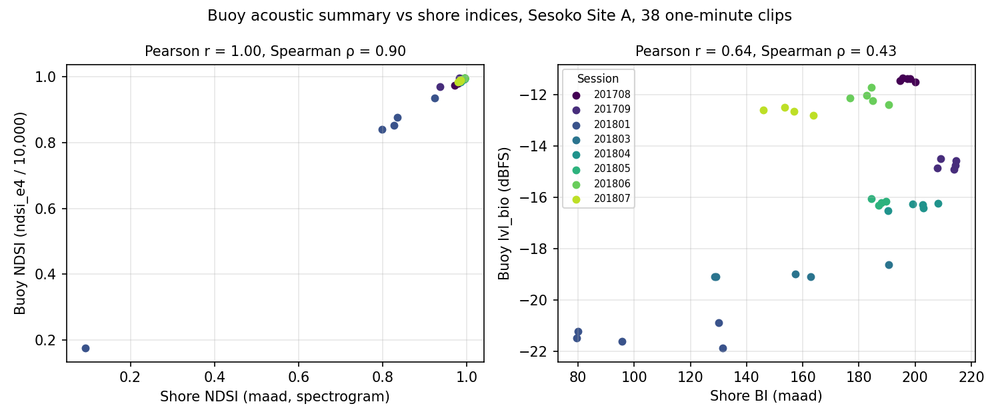

# Acoustic Summary Validation

> **Summary** — Does the 14-byte acoustic summary the buoy sends ([ADR-0010](../decisions/0010-acoustic-summary-over-lora.md))
> track the shore indices it stands in for? On 38 one-minute Sesoko clips, buoy NDSI follows
> shore NDSI closely (Spearman ρ = 0.90) and the bio-band level follows shore BI loosely
> (ρ = 0.43). Re-run 2026-10-25 after the shore pipeline was fixed to really analyse at
> 22.05 kHz ([SCO-235](https://linear.app/scout1/issue/SCO-235)); the first run, against the
> 44.1 kHz shore indices, gave ρ = 0.91 and 0.46. Good enough for a live trend indicator between SD-card recoveries; not a
> replacement for the shore indices. Also records the estimated CPU cost on the Feather M0.

---

## Method

Script: [`analytics/validate_acoustic_summary.py`](../../analytics/validate_acoustic_summary.py).
Data: the longitudinal set, Sesoko Island Site A, 1.5 m, midnight sessions Aug 2017 – Jul 2018,
the first **60 s** of each 5-minute file (one buoy clip), 38 files (two sessions have four
files). See the [bioacoustic methodology](coral-bioacoustic-methodology.md#data-sources) for the
dataset.

Each clip is processed twice:

| Path | What it does |
|---|---|
| **Shore** | BI and NDSI exactly as `utils/acoustic_indices.compute_all_indices` computes them: left channel, detrended, resampled to 22,050 Hz, same spectrogram settings, same 60 s |
| **Buoy** | Resampled to 22,050 Hz, quantised to 12-bit ADC codes (full scale = the file's full scale), then the reference summary [`utils/acoustic_summary.py`](../../analytics/utils/acoustic_summary.py), which the firmware matches bit for bit |

Reproduce (about 2 minutes on 6 cores):

```bash
cd analytics && python validate_acoustic_summary.py --out /tmp/acoustic-validation \
    --plot ../assets/diagrams/acoustic-summary-validation.png
```

Per-clip results: [`acoustic-summary-validation-results.csv`](acoustic-summary-validation-results.csv).

## Results



| Pair | n | Pearson r | Spearman ρ | Reading |
|---|---|---|---|---|
| Buoy NDSI vs shore NDSI | 38 | 0.999 | 0.898 | Tracks closely. Pearson is inflated by one boat-noise clip (2018-01-01 00:05, shore NDSI 0.09); without it r = 0.993, ρ = 0.890 |
| `lvl_bio` vs shore BI | 38 | 0.636 | 0.432 | Same direction, loose. Sessions separate cleanly, clips within a session do not |
| `snap_count` vs shore BI | 38 | −0.476 | −0.419 | Inverse: see below |

All three are significant at p < 0.01.

**NDSI.** The buoy value runs slightly higher than the shore value on a shrimp-dominated reef
(mean 0.96 vs 0.95) because it uses filtered time-domain energy rather than spectrogram power,
but it moves with the shore value, including the one clip where a boat drove the shore NDSI to
0.09 (buoy 0.17). This is what ADR-0010 expected: a trend, not the shore number.

**Bio-band level vs BI.** BI is the area under the spectrum above its minimum in 1–8 kHz, so it
measures how much the bio band stands out from the quietest bin, not only how loud it is. The
bio level is plain loudness. The two agree on which months were loud (Aug and Sep 2017, Apr and
May 2018) and which were quiet (Jan and Mar 2018), and disagree inside a session.

**Snaps.** 1,566–4,217 snaps per clip, 26–70 per second, never near the 65,535 saturation. The
count falls as BI rises: when the chorus is dense, the running floor rises with it and fewer
individual snaps clear 8× the floor. The snap count therefore reports individually resolvable
snaps, not chorus intensity, and is best read alongside `lvl_bio`. The threshold is steep: on a
20 s test clip, 6× the floor counted 2.7× as many snaps as 8×, and 12× counted almost none.

**Clipping.** The Sesoko recordings run hot: 964–5,014 samples per clip (0.07–0.4%) sit within
16 counts of a rail after quantisation to 12 bits, so most clips would raise the dashboard's
clipping warning (≥ 0.1%). That is a property of these recordings' gain, not of the summary; the
buoy's gain is set by the amplifier choice ([SCO-216](https://linear.app/scout1/issue/SCO-216)).

## Limits

- **Levels are dBFS.** They depend on the recording's gain; here, the Sesoko recorder's. They
  convert to dB re 1 µPa only once the S.C.O.U.T. amplifier gain and the hydrophone sensitivity
  are known.
- **One site, midnight only, 38 clips.** No dusk or daytime clips and no second site, so the
  correlations describe this reef at night.
- **Shore BI is on the 22.05 kHz scale** (79–215 on these clips) since SCO-235; values from before
  2026-10-25 were on the 44.1 kHz scale (about a quarter of these) and are not comparable.
- **The 12-bit quantisation maps the file's full scale to the ADC's full scale.** The real
  buoy's mapping depends on the preamp gain.

## Cost on the Feather M0 (estimate, not measured)

The per-sample path compiles (`arm-none-eabi-g++ -Os -mcpu=cortex-m0plus`) to a 96-instruction
biquad and a 269-instruction sample loop (with the snap detector inlined). Each biquad also calls
the 64-bit multiply and two variable 64-bit shifts from libgcc. Counting about 75 executed
instructions per biquad at about 1.4 cycles each, plus 35–60 cycles for the helper calls, gives
roughly **150–170 cycles per biquad**, so about 900–1,020 for the six, and about 150–200 for the
rest of the loop. **Estimate: 1,050–1,250 cycles per sample**, which is **48–57%** of the 2,177
cycles available per sample at 48 MHz and 22,050 Hz. Code size is about 1.5 KB plus the libgcc
helpers; RAM is about 150 bytes of state.

That is a large share before SD writes, and it must be measured on hardware with the capture
path ([SCO-231](https://linear.app/scout1/issue/SCO-231)), including the dropped-sample check.
If it is too slow, the arithmetic can be specialised per section (constant shifts, a 32-bit path
for the sections whose gain fits) without changing a single output bit, since the golden vectors
pin the results. The FFT bands under consideration in
[SCO-234](https://linear.app/scout1/issue/SCO-234) would compete for the same headroom.
