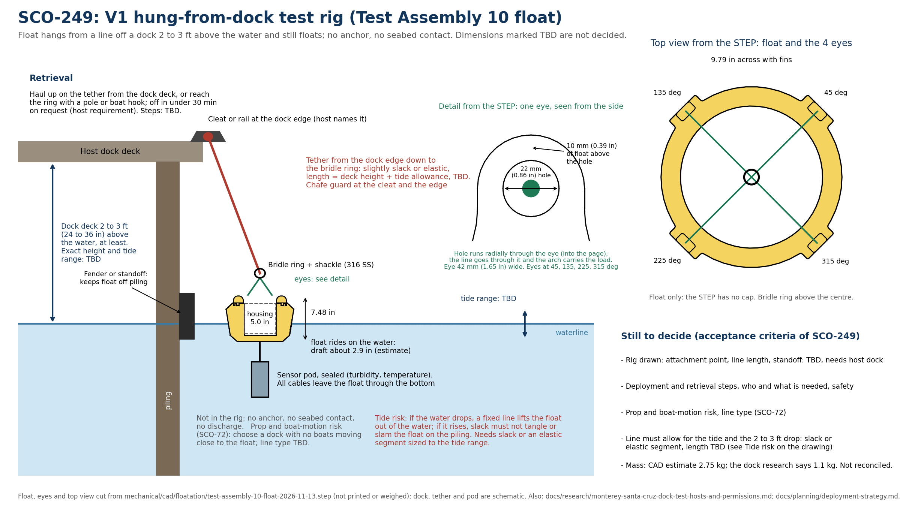

# Dock-Hung Test Rig and Procedure (V1)

> **Summary** — How the S.C.O.U.T. float is hung from a host's dock for the real-seawater systems
> test: the rig, how to size the line for the tide, who is needed, the deployment, daily check and
> retrieval steps, the abort rules and what to record. Written for [SCO-249](https://linear.app/scout1/issue/SCO-249);
> it feeds the [ocean flotation test plan](../planning/ocean-flotation-test-plan.md)
> ([SCO-183](https://linear.app/scout1/issue/SCO-183)) and the host request
> ([SCO-195](https://linear.app/scout1/issue/SCO-195)). **Drafted 2026-11-20 and not yet run.** Every
> number marked *proposed* is a pass mark or limit written before the run; the team confirms it
> before the first deployment. Nothing here is a permit: the host's written yes comes first.
>
> Part of [`docs/engineering/`](.). Test stage: [Layered Test Protocol](layered-test-protocol.md)
> stage 12. Drawing: [`ta10-dock-hung-test-rig-v1-2026-11-17.png`](../../assets/diagrams/ta10-dock-hung-test-rig-v1-2026-11-17.png).

---

## 1. The rig in one paragraph

The float (Test Assembly 10, with the sealed electronics housing and the sensor pod under it) hangs
from a 3/8 in nylon line off a cleat or rail that the host names. The float rides on the water; the
line only keeps it from drifting. There is **no anchor, no seabed contact and no discharge**. A
fender or standoff keeps the float off the piling. All sensor cables leave the float through the
bottom. The test lasts about one week, is checked every day and can be removed in under 30 minutes
when the host asks.

## 2. What is decided and what is not

| Item | Status | Value or rule |
|---|---|---|
| Line | **Decided** (2026-09-08, [decision log](../hub/decision-log.md)) | 3-strand twisted nylon, 3/8 in (9.5 mm). Twisted so a propeller fouls rather than cuts it; nylon gives shock compliance. Closes [SCO-72](https://linear.app/scout1/issue/SCO-72) for line type |
| Attachment on the float | **Decided** in CAD (Test Assembly 10) | 4 hanging loops at 45, 135, 225 and 315 degrees, each a 22 mm (0.86 in) hole through an arch with 10 mm of float above the hole; eased edges. The hole clears the 3/8 in line (the 2026-10-30 rule is at least 0.56 in) |
| Bridle | Proposed | Four short legs of the same line from the loops to one 316 stainless ring and shackle above the centre. The tether runs from the dock to that ring |
| Float draft and freeboard | Estimate only | Draft about 2.9 in, GM 1.30 in, from the CAD, not the full solver. **Not printed or weighed** ([facts.md](../hub/facts.md)) |
| Float mass | **Unreconciled** | The CAD estimate is 2.75 kg; the dock research says 1.1 kg dry. Weigh the printed float and the complete unit before the test and record both. Do not size anything from either number until weighed |
| Dock height above water | **Host-specific** | The drawing assumes at least 2 to 3 ft (24 to 36 in). Measure at the chosen dock |
| Tide range at the dock | **Host-specific, not recorded** | Read from the NOAA tide table for the nearest station and confirm with the dock host ([§3](#3-sizing-the-line-for-the-tide)) |
| Standoff or fender | Open | Any soft fender that keeps the float more than one float radius (about 5 in) from the piling or hull. Choose after the dock is known |
| Chafe guard | Open | Hose or split-tube sleeve at the cleat and at the dock edge. Choose after the dock is known |

## 3. Sizing the line for the tide

Two dock types behave differently. **Ask the host which it is before anything else.**

| Dock type | What happens | Rig |
|---|---|---|
| **Floating dock** (marina finger or guest dock) | The deck rises and falls with the water, so the deck-to-water height stays about constant | A short fixed line, just long enough to hang the float clear of the dock edge. No slack allowance needed. **Preferred** |
| **Fixed pier or wharf on pilings** | The deck stays put and the water moves, so the drop changes with the tide | A line with a tide allowance, as below |

For a fixed pier:

1. Read the predicted tide range for the test week (lowest and highest water) from the NOAA tide
   table for the nearest station. Call the range `R`.
2. Measure the deck height above the water at the **lowest** water, `H_max`, and at the
   **highest**, `H_min = H_max − R`. Measure the horizontal distance from the cleat to the float
   standoff, `d`.
3. **Minimum line length** so the float is never lifted out of the water at low water:
   `L_min = sqrt(H_max² + d²)`, plus the bridle height and 6 in for knots.
4. At high water the same line is slack by about `R`. That slack must not tangle the float or let it
   slam the piling. Absorb it with an **elastic segment** (a length of shock cord in series with the
   nylon, stretching by about `R` over its working range) or a **sliding ring on a vertical guide
   line** along the piling. Pick whichever the host allows.
5. If `R` is larger than the deck height, the deck is too low for a fixed line to work at the
   highest water. Pick another dock or move the cleat.

The drawing's note that the dock stands 2 to 3 ft above the water is a minimum for the float and
bridle to hang clear. **Not recorded:** the actual dock height, tide range and elastic segment
length. Fill them in on the test record once the dock is named.

## 4. Parts and tools

Prices are not recorded; add them to the purchase request once the dock is named.

| Item | Spec | Note |
|---|---|---|
| Tether line | 3/8 in 3-strand twisted nylon, length from §3 plus the bridle | Check the rated breaking strength on the purchased line; the static load is under 6 lb at the 2.75 kg estimate |
| Bridle legs | Same line, four legs, eye-spliced or knotted per the host's rules | |
| Ring and shackle | 316 stainless, rated well above the float weight | |
| Elastic segment | Shock cord or snubber, only on a fixed pier | |
| Chafe guard | Sleeve at the cleat and at the dock edge | |
| Fender or standoff | Keeps the float off the piling or hull | |
| Contact tag | Weatherproof: "Research test, SCU S.C.O.U.T.", dates, name and phone | Required by hosts; see the [hosts research](../research/monterey-santa-cruz-dock-test-hosts-and-permissions.md) |
| Cable lock | Optional, against theft | Or accept the loss and photograph before and after |
| Boat hook or pole | Reaches the bridle ring from the deck | For retrieval |
| Spare line, knife, gloves | | A cut-and-release option if the line fouls |
| Life jackets | One per person on the dock | |
| Scale, tape, camera, notebook | | Weigh and photograph before and after |
| Laptop and shore station | Shore station on land within radio range of the dock | Never transmit without an antenna attached |

## 5. People and roles

Never work alone on a dock. Minimum **two people**, three preferred.

| Role | Job |
|---|---|
| Handler | Lowers and hauls the float on the tether. Stays behind the dock edge line |
| Spotter | Watches the water, boats and animals; holds the boat hook; calls an abort |
| Recorder | Photographs, times each step, fills the test record, runs the shore station |

Everyone follows the host's dock rules and wears a life jacket. Tell the host in writing that the
float carries sealed lithium primary cells (Li-SOCl₂ D cells, [ADR-0007](../decisions/0007-primary-cell-power-source.md)) with no charging.

## 6. Before the day (T minus 7 to T minus 1)

| # | Step | Done when |
|---|---|---|
| 1 | The host's written yes is on file, with the cleat or rail, dates and a contact number | Filed in the repo |
| 2 | Off-campus site, supervision plan and emergency procedure added to the SCU hazard assessment form and approved by the advisor | Advisor's approval on the form |
| 3 | Pass marks in §9 confirmed by the team and copied into Part A of a new test record (plan locked before the run) | Record started |
| 4 | Float printed, coated, sealed and weighed; unit complete with electronics and sensor pod | Dry mass recorded; humidity and leak sensor baseline logged |
| 5 | Bench chain passes: sensors read, packet received at the shore station ([SCO-182](https://linear.app/scout1/issue/SCO-182), stage 11) | Record linked |
| 6 | Tether built to the dock's measured geometry; knots and splices tied; ring and shackle seized | Tug-tested to several times the float weight |
| 7 | Contact tag fitted; photographs taken from four sides and of the underside | Photos filed |
| 8 | Weather and tide checked: no small-craft advisory, swell and wind inside the §8 limits | Go decision written |
| 9 | Shore station site chosen and radio range from the dock confirmed on land | Test packet received from the dock edge |

## 7. Deployment (day 0)

1. Brief everyone on the roles, the abort rules (§8) and the retrieval plan. Confirm the host
   contact is reachable by phone.
2. Photograph the dock, cleat, standoff and waterline before anything goes in the water.
3. Antenna on. Power the unit and confirm one packet reaches the shore station while still on the
   dock deck. Log the time.
4. Tie the tether to the host's named cleat or rail with the chafe guard in place. Check the knot
   and the sleeve twice.
5. Lower the float on the tether by hand, handler on the dock, spotter watching the water. Do not
   drop it.
6. Let it settle. Measure and photograph the freeboard at four points around the float. Check it
   sits upright and the waterline is below the lid seam.
7. Set the fender or standoff so the float cannot touch the piling at the highest and lowest water.
8. Watch for 15 minutes: the line stays slack or elastic, nothing tangles, no boat wake slams the
   float against the dock.
9. Record the deployment time, tide state, water temperature reading from a reference thermometer,
   and the first two packets.
10. Leave only when the float is stable and the shore station is receiving.

## 8. Daily check and abort rules

**Daily check (5 to 10 minutes, same time each day, two people):**

| Check | Look for |
|---|---|
| Float | Upright, same freeboard (photograph), no damage, no animals on it |
| Line | Chafe at the cleat and dock edge, fraying, twist, slack or tension at the current tide |
| Standoff | Float clear of the piling |
| Data | Packets received since yesterday; humidity and leak channel; battery state |
| Fouling | Photograph the waterline and the pod; light wipe is not allowed (fouling is part of the test) |
| Host | Anything the host or other boaters raised |

**Abort and retrieve now if any of these happen** (limits are *proposed*; the host's rules override):

| Trigger | Action |
|---|---|
| The host asks, or a harbor official asks | Retrieve within 30 minutes |
| Small-craft advisory, wind or surge that slams the float into the dock | Retrieve |
| Leak sensor or humidity alarm | Retrieve and keep the unit sealed for inspection |
| A boat, kayak or animal is entangled or at risk | Release the line at the cleat and call the host and, if a person is in danger, 911 |
| Visible chafe through the outer strands of the line | Replace the line or retrieve |
| Float found capsized, flooded or adrift | Retrieve and log; do not re-deploy until inspected |
| Any person unsafe on the dock | Stop |

Marine mammals: sea lions rest on marina docks. Keep clear, keep no loose slack, and never
approach or disturb an animal. If one is on the float or the line, leave it and call the host.

## 9. Pass marks (proposed, to be confirmed before the first run)

A pass needs a recorded test that meets these written targets (the project's scoring rule). These
extend stage 12 of the [Layered Test Protocol](layered-test-protocol.md) ("floats at the modelled
waterline in open water; self-rights; no leaks").

| # | What is measured | Pass mark | How |
|---|---|---|---|
| 1 | Float stays upright and afloat | Upright at every daily check for 7 days | Photo at each check |
| 2 | Freeboard against the model | Within ±0.5 in of the modelled value at deployment and on day 7 (the stage-7 rule) | Tape at four points; model value recorded first |
| 3 | No water in the housing or pod | Leak and humidity channel never alarms; dry mass after retrieval within 10 g of dry mass before (proposed; scale resolution not recorded) | Logger plus same-scale weighing |
| 4 | Tether and rig | No chafe through the outer strands; float never lifted out of the water; never touched the piling | Daily photos |
| 5 | Radio link from the dock | At least 90% of scheduled packets received over the week (stage-10 target is 95% or more for the soak; this is a first dock run) | Shore station log against the firmware interval |
| 6 | Fouling and corrosion | Photographed and weighed before and after; no pass mark, the data is the result | Photos and scale |
| 7 | Retrieval | Float out of the water in under 30 minutes from the call | Stopwatch on a practice retrieval on day 0 and the real one |

## 10. Retrieval (planned or on request)

1. Call the host contact and tell them the retrieval has started. Log the time.
2. Two people on the dock, roles as in §5. Life jackets on.
3. Photograph the float in place, then the waterline.
4. Haul the float up on the tether by hand. If the dock is too high for hand hauling, reach the
   bridle ring with the boat hook and bring it to the edge, then lift by the ring, not by the
   cables.
5. Lay the float on a towel on the deck. Do not open the housing on the dock.
6. Photograph all sides and the underside. Note fouling, damage and the line wear.
7. Rinse with fresh water, dry, weigh the complete unit, and record the mass against the day-0
   value.
8. Download the logger and the shore station data the same day.
9. Remove the tether, the standoff and the tag. Leave the dock as found; tell the host it is done.
10. Hold the unit sealed until the team opens it together, then record the inside (water, salt,
    humidity).

**Emergency retrieval** (§8 abort): if safety needs it, skip the photographs in steps 3 and 6 and get the float out first. A float that cannot
be reached is released at the cleat and the host is called at once; a lost float is a loss to log,
not a reason to take a risk.

## 11. Records

Use the [test record template](test-record-template.md) with Part A (plan and pass marks) written
before the run. File it as `mechanical/test/rr-NN-dock-hung-systems-test-YYYY-MM-DD.md`, add its row
to the [risk-reduction register](../../mechanical/test/risk-reduction-register.md) and to the
[Requirements Test Matrix](requirements-test-matrix.md), and link the Linear issue. Fields not
recorded are written as `Not recorded`.

## 12. Open items

- Dock, host and cleat are not chosen. See the [hosts research](../research/monterey-santa-cruz-dock-test-hosts-and-permissions.md) and [SCO-195](https://linear.app/scout1/issue/SCO-195), [SCO-306](https://linear.app/scout1/issue/SCO-306).
- Float mass is unreconciled (2.75 kg CAD against 1.1 kg dock research); the float is not printed or weighed ([SCO-308](https://linear.app/scout1/issue/SCO-308)).
- Tide range, deck height and elastic segment length depend on the dock.
- The 22 mm loop holes and the arch web need the printed hang test with several times the float weight before the rig is trusted ([decision log 2026-10-30](../hub/decision-log.md)).
- Insurance: whether SCU covers a student project in a public harbor is not recorded.
- Parts cost is not recorded and is not in a funding request yet.
