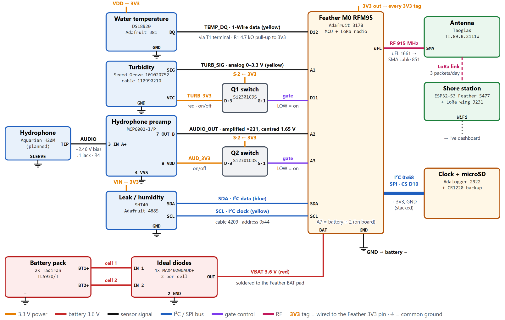

# Project Specifications and Functional Block Diagram, 2026-11-01

> **Summary** — The ECEN 194 Senior Design I team assignment of 2026-11-01: thirteen user needs,
> each with a measurable specification and a marginal (minimum acceptable) and ideal (target)
> value, and the updated Level 1 functional block diagram. Converted from the submitted Word
> document; the content is unchanged. The bench test records cite these specs by number
> ([RR-25](../../hardware/test/rr-25-controller-and-sensor-bring-up-2026-10-29.md),
> [RR-26](../../hardware/test/rr-26-ds18b20-water-step-response-2026-11-03.md)); the
> [Requirements Test Matrix](../engineering/requirements-test-matrix.md) maps them to tests.

## Specifications

| # | User need | Imp. | Specification | Units | Marginal | Ideal |
|---|---|---|---|---|---|---|
| 1 | Measures water temperature to track coral bleaching | 5 | Temperature accuracy | °C | ±1.0 | ±0.2 |
| 2 | Measures water clarity | 4 | Turbidity | NTU | relative change | ±10 % |
| 3 | Records reef sound | 3 | Audio bandwidth | Hz | 100–5k | 10–20k |
| 4 | Samples often enough to see daily and tidal cycles | 4 | Sample interval | min | 60 | 15 |
| 5 | Sends data to shore without a boat trip | 5 | Radio range | km | 0.5 | 2 |
| 6 | Keeps all data if the radio link fails | 4 | On-board storage | months | 3 | 12 |
| 7 | Shows the data on a public dashboard | 4 | Delay to dashboard | h | 24 | 1 |
| 8 | Lasts a full season without a battery change | 5 | Battery life | months | 3 | 12 |
| 9 | Keeps the electronics dry | 5 | Depth rating | m | 2 | 10 |
| 10 | Stays upright so the antenna stays above water | 4 | Self-righting angle | deg | 90 | 180 |
| 11 | Is cheap enough to build several | 4 | Electronics cost per buoy | $ | < 1,000 | < 500 |
| 12 | Does not harm the reef | 5 | Toxic (copper) antifouling | yes/no | no | no |
| 13 | Uses the radio band legally | 5 | Band; transmit power | MHz; dBm | 902–928; ≤ 30 | 902–928; ≤ 14 |

Imp. = importance, 1 (nice to have) to 5 (critical). Marginal = minimum acceptable; Ideal = target.

## Updated functional block diagram

Level 1 system architecture: blocks are subsystems; labeled lines are the power, signal, data
and RF connections between them.

### Design of the diagram

We laid out the diagram so it reads left to right, the same way the data moves through the
buoy. The sensors are on the left, the microcontroller is in the middle, and the antenna,
storage and shore station are on the right. The batteries are at the bottom since they power
everything. Each line is labeled with what it carries, and the colors match the legend at the
bottom. The numbers in brackets refer back to the specs above.

The Feather M0 RFM95 is the main board. It has the microcontroller and the LoRa radio together,
and it wakes up every 30 minutes, reads all the sensors, saves the data and goes back to sleep
to save power [4, 8]. The DS18B20 probe measures water temperature, which is what we need to
track coral bleaching [1]. The turbidity sensor measures how cloudy the water is and sends back
an analog voltage [2]. The hydrophone picks up reef sound, and the preamp boosts that signal so
the board can actually record it [3]. Q1 and Q2 are transistor switches that turn the turbidity
sensor and the preamp off when they aren't being used, which is a big part of how we get the
battery to last a whole season [8]. The SHT40 sits inside the sealed housing and lets us know if
water is getting in, because the humidity jumps [9]. The clock and microSD card time-stamp every
reading and keep a full copy of the data on the buoy in case radio packets get lost [6]. The
antenna sends the data three times a day to the shore station, which uploads it to the public
dashboard [5, 7, 13]. Finally, the battery pack is two lithium D cells connected through ideal
diodes so one cell can't charge the other, which is a safety requirement for these batteries [8].

---

AI use: Claude AI (Anthropic) was used to help write and format this document. Specifications
and the block diagram are from the team's own design work.
