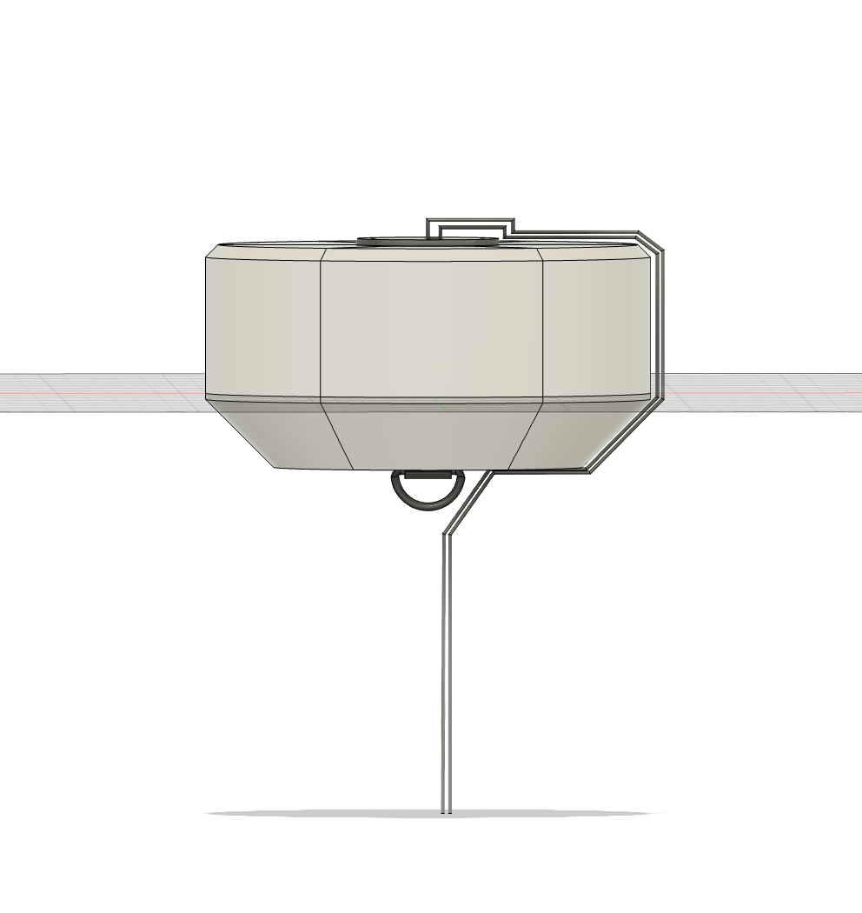
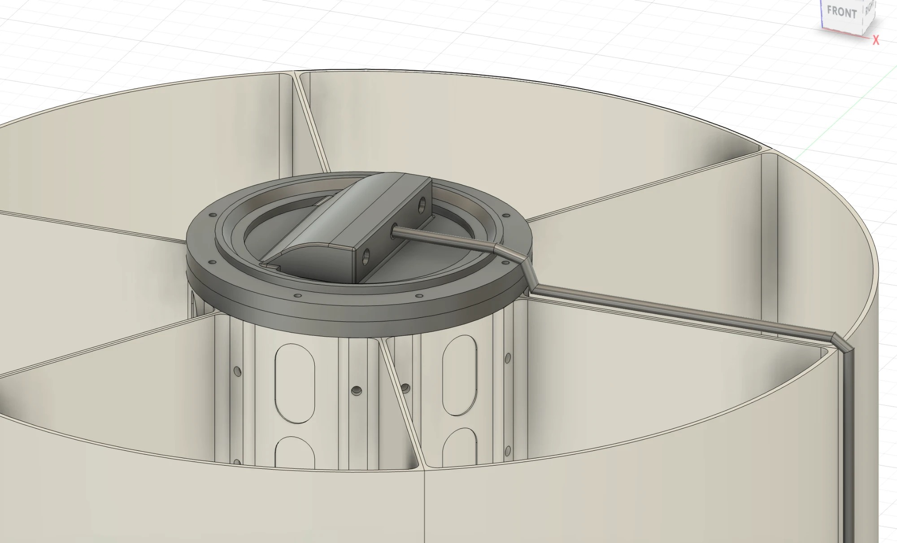
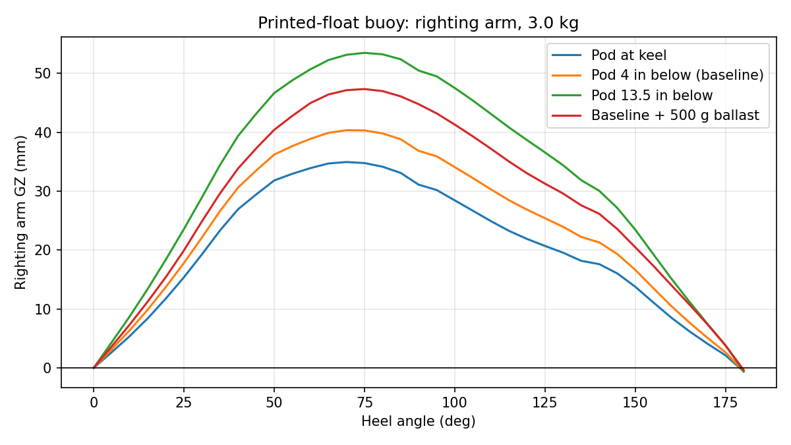

# Chapter 5: Detailed Design and Implementation

> **Summary** — Working draft of thesis chapter 5, Detailed Design and Implementation. Write here; the structure follows
> [Thesis Outline](../planning/thesis-outline.md). Status: section 5.1 drafted 2026-11-13; 5.2 onward not started.

**Source material in the repo:** docs/engineering/buoy-structural/, mechanical/, hardware/, firmware/, docs/engineering/power-budget-update-2026-10-05.md, docs/engineering/shore-station.md

---

## 5.1 Mechanical Design

> **How this section is organised.** Each part gives the **concept** (what was designed), the **context** (why it was
> needed), the **iteration** (what was tried and dropped), the **result** (the numbers) and the **impact** (what the
> analysis changed in the design). The full derivations, inputs and sources are in
> [Appendix C](appendix-c-calculations.md) and the tests in [Appendix D](appendix-d-test-procedures-and-logs.md); only
> the representative results are repeated here. The design changed twice during the project: a six-wedge bolted ring with
> foam and a lead ballast arm (to 2026-10-14), then a single printed float with no foam and no lead. Analyses are marked
> accordingly.

Buoyancy sets everything else, so every mechanical analysis starts from Archimedes' principle:

```
F_b = ρ g V            ρ = 1025 kg/m³ (seawater), g = 9.81 m/s², V = displaced volume
```

Draft is found by integrating the revolved hull profile until the displaced weight equals the buoyant force
([C.4.2](appendix-c-calculations.md#c42-whole-buoy-mass-displacement-and-freeboard-model)).



*Figure 5.1. The assembled wedge-design buoy with cable routing. Representative CAD for the design the loads, buckling
and stability work below were run on. Later float geometry: [Test Assembly 10](../../mechanical/cad/floatation/test-assembly-10.md).*

### 5.1.1 Flotation and Hull Structure

**Concept.** A ring of six bolted, 3D-printed wedges around a central chassis, foam-filled, later replaced by a single
printed float around the electronics housing.

**Context.** The structure had to survive a defined worst case, not a guess. The design environment was fixed on
2026-09-08 for a **2 m** shallow-water survival case: 1.2 m wave height, 6 s period, 0.8 m/s current and 22 m/s wind
([C.1.1](appendix-c-calculations.md#c11-design-environment)). Those inputs gave nine load cases; the governing horizontal
case was wave plus current at about 440 N on v4 and about 330 N on v5, with a 586 N resultant at the shackle for v4
([C.1.3](appendix-c-calculations.md#c13-computed-load-cases-wedge-design-then-recomputed-for-v5)).

**Iteration and result.**

| Step | Analysis | Result | What it changed |
|---|---|---|---|
| Side-load FEA, 300 N, 2026-08-17 (RR-01) | Static stress in Fusion | Minimum safety factor 25.4 against a mark of 4 | The walls were over-built, so they were thinned to 0.095 in (outer) and 0.063 in (sides) |
| Wall check, 2026-09-07 (RR-05) | Hoop stress `σ = pR/t` at 50.3 kPa (5 m) | 4.77 MPa, safety factor 7.3 | Strength was fine, but thin open walls flex on the print bed, so an internal bracing web became mandatory |
| Ring buckling, 2026-09-09 (RR-06) | Curved-panel buckling, with and without foam | Bare wall safety factor 0.2 to 0.7 (fails); foam-backed 3 to 5 (passes) | Foam fill is required before submersion |
| v5 load re-scale | Loads recomputed from v4 | Every v5 load 10 to 30% lower than v4 | The v4 FEA bounds v5, so no full re-run was needed |
| Freeboard model | Whole-buoy mass and equilibrium | v4: 8.40 kg, draft 2.69 in, margin 4.75:1; v5: about 7.75 kg, draft 2.53 in, margin 3.84:1 | The design was judged over-floated, which allowed the later move to a smaller float |

**Impact.** The analyses took the wedge ring from "strong enough" to "as light as the loads allow", and they exposed the
rule that foam is structural, not optional. That rule, plus the stability result in
[5.1.4](#514-stability-and-self-righting-ballast), is what drove the 2026-10-14 switch to a single printed float. The
printed float (v9, 992 g, 2026-10-16) floats at 2.56 in draft with 3.94 in of freeboard at 2.87 kg total
([C.5.4](appendix-c-calculations.md#c54-printed-float-stability-study-and-tip-explorer-2026-10-14-to-10-16-printed-float)).
The current geometry is Test Assembly 10 (2026-11-11), not yet printed or weighed.

### 5.1.2 Chassis, Load Path, and Mooring

**Concept.** A through-bolted 316 stainless pad-eye carries the mooring line load into the structure; the line is
3/8 in three-strand twisted nylon (decisions of 2026-08-29 and 2026-09-08,
[ADR-0004](../decisions/0004-reef-safe-anchoring-and-mooring.md)).

**Context.** The buoy will sit near coral, so the mooring has to be both strong and reef-safe: no chain dragging, a line
that a boat propeller cannot wrap, and an anchor that never touches coral. That is the **permitting-driven** side of the
design, covered in [9.6](09-professional-issues-and-societal-impact.md#96-legal-and-regulatory-compliance).

**Iteration and result.** The pad-eye was chosen over a rigid U-bolt with a backing plate, a clamped cable loop, a bonded
flanged eye, a tapped block and a cross-pin clevis. The mooring load cases LC2 to LC9 were run in FEA (RR-04, 2026-08-29)
and passed with safety factors of 10 to 1450 (ring-contact artifacts aside). The bolt group was hand-checked for the
combined LC9 snap load (810 N at 37° on v4, 2× the vertical load) and LC7 overturning moment (about 70 N·m)
([C.9.11](appendix-c-calculations.md#c911-mooring-bolt-group-check-lc9-with-the-lc7-moment)). The hang-hole version for the
printed float was checked statically in RR-20 (2026-10-30).

**Impact.** The attachment height was also tested against heel. The force needed to knock the buoy down to its peak
righting moment (about 21.5 N·m at about 63°) is 604 N at the keel pad-eye, 217 N at a collar 2.5 in below, and only 33 N
if attached at the stem bottom, against about 21 N of ordinary current drag
([C.9.18](appendix-c-calculations.md#c918-mooring-attachment-height-knockdown-force)). That is why a low attachment on the float is
preferred to one on a long stem.

### 5.1.3 Electronics Housing, Sensor Pod, and Sealing

**Concept.** Static face seals using purchased AS568 O-rings, with the housing and pod printed in PETG and the heat-set
inserts pressed in from the bottom.

**Context.** A leak ends a deployment, and the target is 5 m (50.3 kPa). Early 3D-printed rings and PLA parts were
porous along layer lines, so purchased off-the-shelf rings were chosen and the groove was sized from the ring:
`squeeze = (CS − groove depth)/CS` for 20 to 30%, and gland fill near 75%
([C.6.1](appendix-c-calculations.md#c61-o-ring-face-seal-sizing)).

**Iteration.** The seal took several rounds. A pod run with a TPU-printed ring failed after about a week (RR-07); three
coupon runs failed in October (RR-12 slightly damp, RR-14 leaked, RR-15 flooded) because the flange flexed between bolts
and the 4.76 mm ring did not match a groove cut for 2.62 mm; the fourth matched the groove to the ring (RR-16). Pressing
the inserts from the bottom and printing in PETG then **passed 24 hours** in fresh water (RR-18, 2026-10-21).

**Result.** The electronics housing is fixed at **4.4 in inside diameter by 5 in tall** (2026-10-08) from a packing
budget of real component dimensions
([C.6.3](appendix-c-calculations.md#c63-packing-budgets)), and the sensor pod's dry chamber was enlarged to Ø52 mm or more
because the probe's mounting ears span 44 mm. The pod wall (2.0 mm) has a closed-form safety factor of about 4.7 at 5 m,
not yet FEA-validated. The first cap-and-gland test on the housing (RR-23, Stage 1) **failed**: the housing
took on water (+595 g). The redesigned v2 cap then passed a 4-day soak (reported by John on 2026-11-09, [SCO-296](https://linear.app/scout1/issue/SCO-296);
numbers and test record are still to be filed).

**Impact.** The test series moved the seal from "a ring in a groove" to a **joint** problem: flange stiffness, ring fit
and print material mattered more than the ring itself ([D.7](appendix-d-test-procedures-and-logs.md#d7-lessons-from-the-test-program)).
It also changed the process: every test now states its pass mark before it runs.



*Figure 5.2. The electronics housing flange on the chassis (CAD). Representative of the seal geometry the groove sizing
and tests above refer to.*

### 5.1.4 Stability and Self-Righting Ballast

**Concept.** A hydrostatic solver computes the righting arm (GZ) from the STEP geometry, to check the buoy returns
upright from any angle ([C.5](appendix-c-calculations.md#c5-stability)).

**Context.** The buoy cannot be tended, so it must recover by itself from a wave roll or a capsize. The target was
self-righting from any angle, set in requirement R-18.

**Iteration and result.** The v5 wedge buoy had a very high small-angle stability (GM about 7 to 9.6 in) but was **stable
inverted** at large angle (RR-11, 2026-09-29), so a capsize would not recover. A lead ballast arm on the v6 caps fixed that
and was sized from lead mass against depth
([C.9.17](appendix-c-calculations.md#c917-sizing-the-ballast-lead-against-depth)). The permitting review had listed lead as a possible
objection ([9.6](09-professional-issues-and-societal-impact.md#96-legal-and-regulatory-compliance)), so on 2026-10-14 the design moved to a printed float that rights itself
without ballast. Its study gave the figures in the table below.

| Quantity | v8 (1154 g float) | v9 (992 g float) |
|---|---|---|
| Total mass | 3.03 kg | 2.87 kg |
| Draft / freeboard | 2.70 / 3.80 in | 2.56 / 3.94 in |
| GM | 1.43 in | 1.47 in |
| Max righting arm | 41 mm at 75° | 40 mm at about 70° |



*Figure 5.3. Righting-arm curve of the printed float. Representative of the stability analysis; the interactive heel
explorer is [`printed-float-tip-explorer.html`](../../mechanical/simulations/buoy-stability/printed-float-tip-explorer/printed-float-tip-explorer.html).*

**Impact.** The float self-rights, but the margin near inverted is thin (GZ about 1 mm at 178° for v8), and the hull
shape, not the mass, drives it. A physical tilt test of the regular buoy body on 2026-11-06 (RR-29) **passed
qualitatively**: it righted itself unaided. The angles, number of releases and water conditions were not recorded, and the
calculator was not re-run for the current geometry, so R-18 is not yet fully closed.

## 5.2 Electrical and Power Design

_Placeholder: Figure: Electrical schematic_

_Placeholder: Table: Daily energy budget by subsystem_

_Draft here._

### 5.2.1 Schematic and Sensor Interfaces

_Draft here._

### 5.2.2 Power Chain and Energy Budget

_Draft here._

## 5.3 Firmware

_Placeholder: Figure: Firmware state diagram_

_Draft here._

### 5.3.1 State Machine, Drivers, and Scheduling

_Draft here._

### 5.3.2 Low-Power Sleep and Fault Recovery

_Draft here._

## 5.4 Communications and Shore Station

_Draft here._

### 5.4.1 LoRa Link Budget and Regulatory Compliance

_Draft here._

### 5.4.2 Packet and Protocol Design

_Draft here._

### 5.4.3 Shore Station and Data Backend

_Draft here._

## 5.5 Data Analytics and Dashboard

_Draft here._

## 5.6 Subsystem and Interdisciplinary Integration

_Placeholder: Figure: Subsystem interface diagram_

_Draft here._
