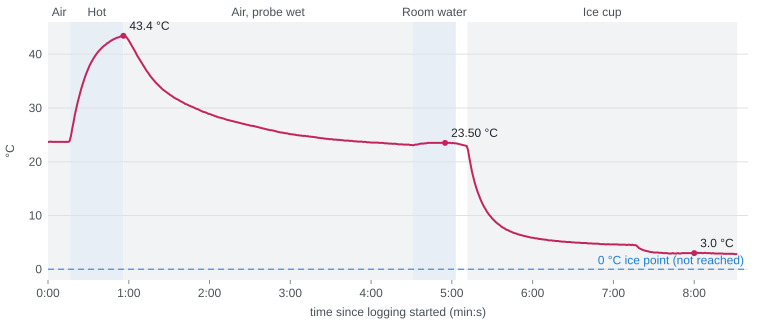

# Water-Temperature Probe — Step Response in Water, 2026-11-03

## One-page summary

|  |  |
|---|---|
| **Test ID / status** | RR-26 · Partial (3 checks pass, response time measured, ice point inconclusive) |
| **Date, duration, who** | 2026-11-03, 12:42–12:51 PST (logging 8.5 min), Isabella Rodriguez |
| **Requirement tested** | R-01 water temperature ([Requirements Test Matrix](../../docs/engineering/requirements-test-matrix.md)): reading with the tip wet, resolution, steadiness, response time; accuracy at 0 °C attempted |
| **Tracking issue** | [SCO-259](https://linear.app/scout1/issue/SCO-259), [SCO-258](https://linear.app/scout1/issue/SCO-258) |
| **Record kind** | Prospective, with gaps: the plan was written 2026-11-03 before the run but not locked in the repo or reviewed (A10); event times inferred from the trace (D-01). Report: [SCOUT-E-TR-002](evidence/rr-26-2026-11-03/scout-e-tr-002-water-temperature-step-test.html) |

**Question.** Does the DS18B20 probe keep reading cleanly with its tip in water, how fast does
it follow a step in water temperature, and does it read 0 °C in an ice bath? Retires the risk
that the probe or logging chain misbehaves wet, and that its lag matters at the buoy's 30-minute
sample interval.

**What we measured and the pass mark.**

| Parameter (unit) | Instrument | Pass if | Measured | Verdict |
|---|---|---|---|---|
| Readings and dropouts | `scout_t3c_water` at 1 Hz, logged by the bench page | One reading per second; 0 dropouts | 513 readings over 512 s; 0 dropouts | Pass |
| Resolution (°C) | Same | Every reading on a 0.0625 °C step | 513 of 513 | Pass |
| Still-bath steadiness (°C) | Same | Within 2 steps (0.125 °C) in a settled bath (set after the run, see A5) | Room water 23.50 °C, span 0.0625; ice cup 3.01 °C, span 0.125 | Pass |
| Step response τ (s) | 63.2 % time from immersion | No pass mark set | Heating 11.6–12.1 s; cooling 13.2 s (still air, RR-25: 150–170 s) | Measured |
| Ice point (°C) | Probe in a packed, stirred ice bath | 0.0 ± 0.5 °C (DS18B20 datasheet) | ≈ 3.0 °C and still falling; bath not at 0 °C | Inconclusive |

**How and steps.** Same stack and probe as [RR-25](rr-25-controller-and-sensor-bring-up-2026-10-29.md);
three thin disposable plastic cups of tap water (hot, room temperature, a few ice cubes in
water), only the steel tip submerged, laptop USB power. Steps as run: (1) probe in air;
(2) into hot water ≈ 40 s; (3) out into air until near room temperature; (4) into room water;
(5) into the ice cup, stirred once when it had settled near 4.5 °C.

**Result.** The probe logged every second with no dropouts and full 12-bit resolution while
wet, held one step steady in room water, and followed both water steps with τ ≈ 12–13 s, about
12 times faster than in still air. The ice cup never reached 0 °C (it settled near 3 °C and was
still cooling), so accuracy at 0 °C is still unchecked.

**Does not establish.**

- Absolute accuracy: no reference thermometer, and the ice point failed as a condition, not as a reading.
- Salt water, depth, or the flight firmware's 30-minute cycle.

**Decision.** Change the ice bath and re-run: a cup packed with crushed ice and a little cold
water, stirred from the start, pass 0.0 ± 0.5 °C; add a reference-thermometer reading in each
bath when one is available ([SCO-259](https://linear.app/scout1/issue/SCO-259)).

---

## Part A — Plan (write and date before the run)

_The plan below was written on 2026-11-03, before the run, as instructions to the operator in a
working session with Claude; it was not committed or sent for review before the run. Changes
after the run are in B3, not here._

### A1. Purpose and risk retired
TR-001 / RR-25 tested the probe in still air only. The buoy measures water, so the probe and
logging chain must work wet, and its response time in water decides whether its lag matters.

### A2. Hypothesis
If the probe tip is moved between baths of different temperature, then the reading follows each
step with a time constant much shorter than in still air (150–170 s), because heat transfer from
water to the steel tip is far higher; and in a packed, stirred ice bath it reads 0.0 ± 0.5 °C,
because that is the DS18B20's rated accuracy.

### A3. Parameters measured

| Parameter | Unit | Instrument / method | Resolution | Uncertainty | Calibrated / checked (date) |
|---|---|---|---|---|---|
| Water temperature | °C | DS18B20 (381), 12-bit, 1 Hz | 0.0625 °C | ±0.5 °C (datasheet, −10 to 85 °C) | Not calibrated; ice point attempted here |
| Time | s | Sketch timer; PC timestamp on each line | 0.1 s (sketch), 1 ms (PC) | Sketch timer ≈ 0.13 % fast vs the PC | Checked against the PC in this run |

### A4. Variables

| Kind | Variable | Value or range |
|---|---|---|
| Varied (independent) | Bath the tip is in | Air, hot, room-temperature, ice water |
| Held fixed (controlled) | Probe, stack, wiring, USB power, immersion (steel tip only), tap water | — |
| Measured (dependent) | Probe temperature vs time | See B2 |

### A5. Success metric (locked)

| # | Metric | Check | Pass if | Why this number | Source (spec, standard, model) |
|---|---|---|---|---|---|
| M1 | Logging chain wet | Present | One reading per second; 0 dropouts | A dropout is a lost sample at sea | RR-25 M2 |
| M2 | Resolution | Plausible | Every reading on a 0.0625 °C step | 12-bit mode | DS18B20 datasheet |
| M3 | Steadiness | Plausible | Span ≤ 2 steps (0.125 °C) in a settled bath | Added after the run: TR-001's "steady" criterion applied to water | RR-25 |
| M4 | Response time τ | Other | Measured; no pass mark | First measurement in water | — |
| M5 | Ice point | Accurate vs reference | 0.0 ± 0.5 °C in a packed, stirred ice bath | Rated accuracy; ice point is a free 0 °C standard | DS18B20 datasheet; [SCO-259](https://linear.app/scout1/issue/SCO-259) |

Locked on: 2026-11-03, before the run, for M1, M2, M4 and M5 (in the working session, not in
the repo). M3 was added after the run.

### A6. Article, setup and sampling

| Item | Value |
|---|---|
| Design revision / file | Breadboard build as RR-25; sketch [`scout_t3c_water`](bench-sketches/scout_t3c_water/scout_t3c_water.ino) |
| Material and print settings | n/a |
| Configuration | Probe red → 3V3, blue → GND, yellow → D12, 4.7 kΩ pull-up; splice and breadboard kept dry and away from the cups |
| Conditions | Tap water; three thin clear disposable plastic cups, a third to half full; room ≈ 23.7 °C (probe in air at start) |
| Sample size and replication | One probe; one step of each kind |
| Control / reference article | None |
| Reference instrument or standard | Ice point (0 °C) only; no reference thermometer |
| Expected values | Air ≈ room temperature; hot tap ≈ 40–50 °C; ice bath 0.0 ± 0.5 °C |
| Before you start (go/no-go) | Only the steel tip in water; splice out of the water; cups on the far side of the table from the board and laptop; no boiling water (PVC cable limit ≈ 100 °C) |
| Data path | USB 115200 baud → [`live-temp-monitor.html`](tools/live-temp-monitor.html) in Edge (Web Serial) → Download CSV |
| Stop and abort conditions | Water near the splice, breadboard or laptop; reading −127 or NaN repeatedly |
| Safety | 3.3 V from USB; hot tap water only |

### A6a. Hazards, damage risks and failure modes

| What could go wrong | What happens | How you would notice | Fix or prevention |
|---|---|---|---|
| Splice or jumpers get wet | Shorts or corrodes the data line; reading drops out | NaN in the CSV; wet joint | Keep only the steel tip in water |
| Spill reaches the board or laptop | Board or laptop damage | Visible | Cups on the far side of the table |
| Ice bath not packed or stirred | Bath above 0 °C; ice point meaningless | Reading settles above 0.5 °C or keeps drifting | Pack with crushed ice, little cold water, stir (happened: D-03) |
| Port held by the Serial Monitor | Page cannot connect | "Could not open port" | Close the Serial Monitor first |

### A7. Procedure

**Prerequisites checklist.** Stack and probe as RR-25; `scout_t3c_water` uploaded; Edge with
the bench page; three cups; tap water, ice; towel.

| Step | Action | Record | Expected | Done |
|---|---|---|---|---|
| 1 | Probe in air, 1 min; mark `air` | Readings | Room temperature, steady | ☑ (16 s) |
| 2 | Into the ice cup, 4 min, stirring; mark `ice` | Readings, ice left at the end | Settles at 0.0 ± 0.5 °C | ☑ as step 5 (D-02, D-03) |
| 3 | Into hot water, 3 min; mark `hot` | Readings | Fast rise, settles | ☑ (≈ 40 s, D-02) |
| 4 | Into cold tap water, 3 min; mark `cold` | Readings | Fast fall, settles | Not done; room water instead (D-02) |
| 5 | Out into air, 2 min; mark `air2` | Readings | Slow return to room | ☑ after the hot dip (D-02) |
| 6 | Download CSV; photo of the setup | Files | — | ☑ |

### A8. Analysis plan
τ is the time from immersion to 63.2 % of the step, by linear interpolation between readings.
Steadiness is the max − min over a settled window. Ice point is the mean of the last settled
minute in ice, compared with 0.0 ± 0.5 °C.

### A9. Curve required

| Curve | Axes and units | Standard or model compared against | Range to cover | Acceptance for the fit |
|---|---|---|---|---|
| Step response | °C vs s | First-order step T(t) = T∞ + (T0 − T∞)·e^(−t/τ) | Air → hot, room → ice | τ reported (no pass mark) |
| Ice-point check | °C | 0 °C ice point | One point | 0.0 ± 0.5 °C |

### A10. Review and open questions

| Reviewer | Sent (date) | Feedback | Change made to Part A |
|---|---|---|---|
| Dr. Shoba Krishnan, Dr. Jes Kuczenski | Not sent before the run | — | None |

Open question: a reference thermometer for the R-01 spot check ([SCO-259](https://linear.app/scout1/issue/SCO-259)). Owner Isabella.

## Part B — Execution log (fill during the run)

### B1. Run record

| Item | Value |
|---|---|
| Start / end (date, time) | 2026-11-03, 20:42:49–20:51:21 UTC (12:42–12:51 PST) |
| Operator | Isabella Rodriguez |
| Ambient conditions | Indoors, ≈ 23.7 °C (probe in air); location Not recorded |
| Instrument serials / IDs | Not recorded (single prototype units) |

### B2. Raw data

Full data: [`test3c-water-steps.csv`](evidence/rr-26-2026-11-03/data/test3c-water-steps.csv)
(513 rows, unedited). No marks were typed; event times below are inferred from the trace and
the operator's account, ±1 s ([run notes](evidence/rr-26-2026-11-03/test3c-run-notes.md)).

| Time (s) | Run / sample | Reading or observation | Reference value | Note |
|---|---|---|---|---|
| 0–16 | Air | 23.69 °C, flat | — | |
| 16.5 | Into hot | Rise starts | — | |
| ≈ 56 | Out of hot | Peak 43.44 °C, still rising slightly | Hot water ≈ 43.5–44.0 °C (inferred) | |
| 56–271 | Air, probe wet | Falls to 23.06 °C, below the start | — | Evaporative cooling |
| ≈ 271–303 | Room water | 23.50 °C, span 0.0625 °C (285–301 s) | — | |
| ≈ 311.5 | Into ice cup | Sharp fall; plateau 4.54 °C (425–436 s) | 0 °C | |
| ≈ 437 | Ice cup stirred | Second drop to ≈ 3.0 °C | 0 °C | Confirmed by the operator |
| 470–492 | Ice cup | 3.01 °C, span 0.125 °C | 0 °C | |
| 500–512 | Ice cup | 2.87 °C, still falling | 0 °C | End of run |

### B3. Deviations

| Time | What differed from A7 | Why | Effect on validity |
|---|---|---|---|
| Whole run | D-01: no event marks typed | Operator's hands busy | Event times ±1 s; τ unaffected beyond that |
| Steps 1–5 | D-02: order and dwell changed: hot first for ≈ 40 s, wet-air cool-down added, room water ≈ 30 s, no cold-tap bath | Run as convenient on the day | Heating τ carries a range (hot dip ended before full settling); steadiness windows 17–23 s, not 1 min |
| Ice cup | D-03: a few cubes floating in room-temperature water, stirred once | Bath made without packing it | M5 condition not met: inconclusive |
| Whole run | D-04: no reference thermometer | None available | Accuracy not checked |

## Part C — Results and decision (fill after)

### C1. Result against the metric

| Metric (from A5) | Measured | Margin | Verdict |
|---|---|---|---|
| M1 logging chain | 513 readings / 512 s; 0 dropouts; PC gaps 0.994–1.005 s | — | Pass |
| M2 resolution | 513 of 513 on 0.0625 °C steps | — | Pass |
| M3 steadiness | Room 0.0625 °C span; ice 0.125 °C span | 0 to 1 step | Pass |
| M4 τ | Heating 11.6–12.1 s; cooling 13.2 s | — | Measured |
| M5 ice point | ≈ 3.0 °C, still falling; bath not at 0 °C | — | Not measured (inconclusive) |

**Overall:** Partial. The probe works wet and responds about 12 times faster than in air; the ice point must be re-run with a proper bath.

### C2. Curve and analysis

Heating step from 23.69 °C at 16.5 s toward 43.5–44.0 °C gives τ = 11.6–12.1 s (the range is
the unknown final value). Cooling step from 22.94 °C at 311.5 s toward the 4.5 °C plateau gives
τ = 13.2 s. Both are about 12 times shorter than RR-25's still-air τ of 150–170 s, and far
below the 30-minute sample interval, so lag does not limit the water reading. The wet probe's
cooling in air (τ ≈ 48 s, settling at 23.06 °C below room) is evaporative and not comparable
with RR-25. The ice cup's two plateaus and continuing fall show a layered bath still cooling,
not a probe offset.

### C3. Validity and limits

- **Sources of error:** event times inferred (±1 s); hot-water final temperature inferred; single run; tap water, not seawater.
- **What this does establish:** the probe and logging chain work with the tip wet; 12-bit resolution; steady in still water; τ ≈ 12–13 s in water.
- **What this does not establish:** absolute accuracy at any temperature; behaviour in salt water or under pressure.
- **Not recorded or shortcut taken:** location; hot-water temperature by a reference; marks; M3 pass mark written after the run.

### C4. Decision

| Question | Answer |
|---|---|
| Good enough to stop redesigning? | Yes for the probe's wet operation and response time; no for accuracy |
| Design change driven by this test | None |
| Re-run needed? | Yes: ice point with a packed, stirred bath, plus a reference-thermometer spot check |
| Next test | Ice-point and reference re-run for R-01 ([SCO-259](https://linear.app/scout1/issue/SCO-259)) |
| Issues filed | None new |

### C5. Evidence and traceability

- Report: [SCOUT-E-TR-002 (HTML)](evidence/rr-26-2026-11-03/scout-e-tr-002-water-temperature-step-test.html), [PDF](evidence/rr-26-2026-11-03/scout-e-tr-002-water-temperature-step-test.pdf)
- Photo: [the three baths](evidence/rr-26-2026-11-03/test3c-setup-cups.webp)
- Data: [`test3c-water-steps.csv`](evidence/rr-26-2026-11-03/data/test3c-water-steps.csv); [run notes](evidence/rr-26-2026-11-03/test3c-run-notes.md)
- Tools: [`scout_t3c_water`](bench-sketches/scout_t3c_water/scout_t3c_water.ino), [`live-temp-monitor.html`](tools/live-temp-monitor.html)
- R-01 → this test → [SCO-259](https://linear.app/scout1/issue/SCO-259); related: [RR-25](rr-25-controller-and-sensor-bring-up-2026-10-29.md)

Format: [Test Record Template](../../docs/engineering/test-record-template.md). Index: [risk-reduction register](../../mechanical/test/risk-reduction-register.md).
