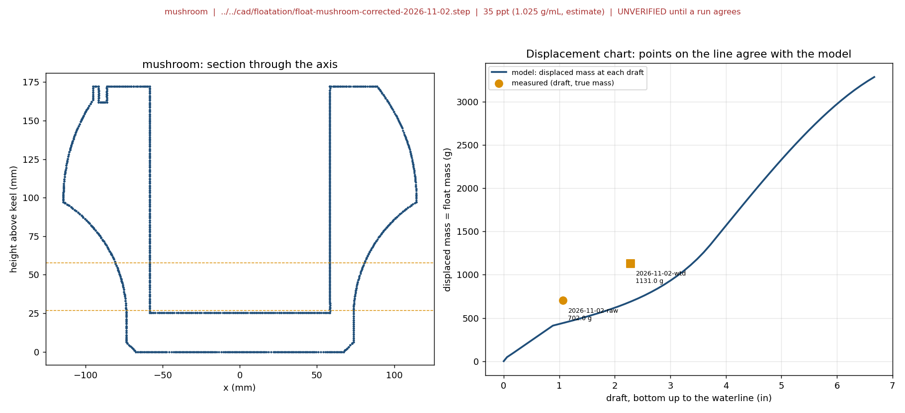
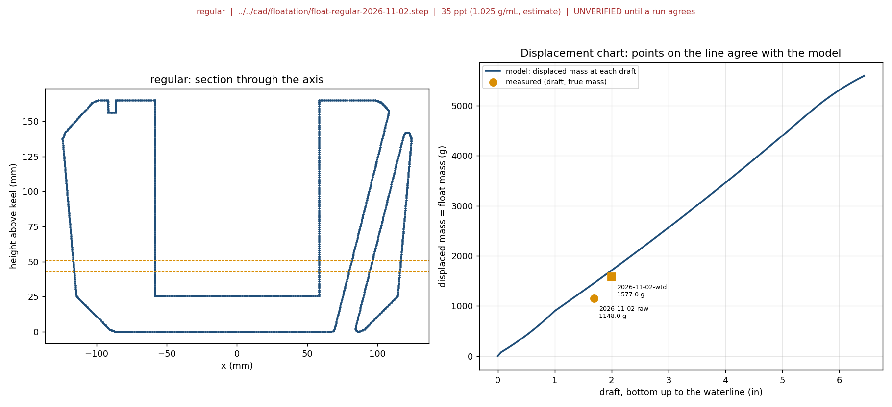

# Float Displacement Charts and Running Log

> **Summary** — A reusable tool and a running log for printed-float buoyancy tests. For each float it turns the
> STEP file into a displaced-mass-versus-draft curve (true 3D hull, simulator method), and plots every logged test
> run on that curve. A run that lands on the line agrees with the model. **Keep adding runs here for every future
> buoyancy test.** Everything is **unverified** until a run agrees with its prediction (see Status).
>
> Part of [`buoy-stability`](../README.md). Data: [`float-displacement-log.csv`](../../../test/float-displacement-log.csv).
> First runs: [RR-21](../../../test/rr-21-tub-salt-substitute-vs-seawater-2026-11-01.md), 2026-11-02.

---

## The two charts (current)

Left panel: vertical section through the float's axis (dashed lines are the measured drafts). Right panel: the
displacement chart, the model's displaced mass at each draft with every logged run as a point. Circles are
bottom-up draft readings, squares are top-down freeboard readings converted to draft.





## How to use it

```bash
cd mechanical/simulations/buoy-stability
python3 -m venv .venv && .venv/bin/pip install -r requirements.txt   # once
.venv/bin/python float_displacement.py --add --run-id 2026-11-03-a --test RR-21 --float mushroom \
    --step ../../cad/floatation/float-mushroom-corrected-2026-11-02.step --float-mass-g 702 --added-g 429 \
    --basis freeboard_from_top --measured-in 4.5 --date 2026-11-03 --notes "what was added and where"
.venv/bin/python float_displacement.py --charts
```

- `--basis draft_bottom_up`: ruler reading from the very bottom of the float up to the waterline.
- `--basis freeboard_from_top`: reading from the top of the float down to the waterline.
- `diff_in` in the log is **measured draft minus predicted draft**: positive means deeper than predicted,
  negative means shallower.
- Predictions use 1.025 g/mL (about 35 ppt at room temperature, an estimate). Pass `--rho` for another water.

## Method and assumptions

- The hull is the true 3D volume of the STEP, voxelised at 3 mm (`assembly.py`): sealed chambers count as
  displacement, the **open central bore above its floor does not** (an earlier body-of-revolution shortcut counted it
  and overstated the volume; do not use it).
- A free float displaces its own mass, so each run's point is (measured draft, total mass).
- Free-surface and tilt effects are not modelled; a float that is tilted, held by hand or resting on something
  gives a reading that is not its free draft. Note this in the log's `notes`.

## Status (2026-11-02)

**Unverified.** The regular float agrees with the model with its weighed mass (about 1148 g) under load, within
0.16 in. The mushroom does not: it sits about 1.1 to 1.3 in shallower than predicted in both runs, with its mass
confirmed (702 g). Candidate causes (not confirmed): the real overall height or base differs from the STEP, the
reading reference, or the held-by-hand reading. Planned next: a heavier-load mushroom run (see the RR-21 open
questions). Until a run agrees, treat the mushroom chart as under check.
