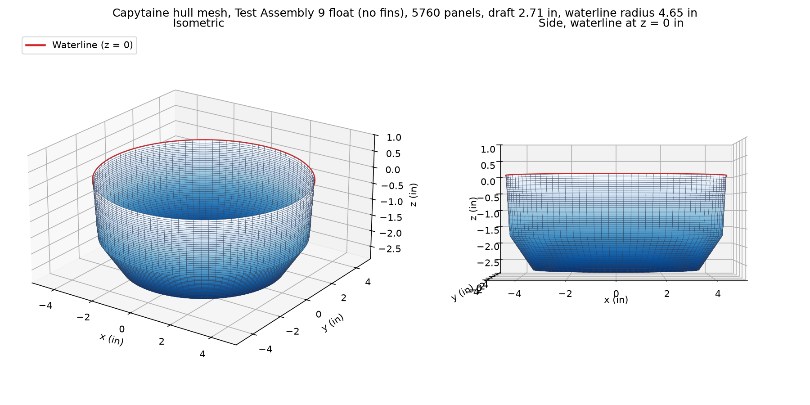
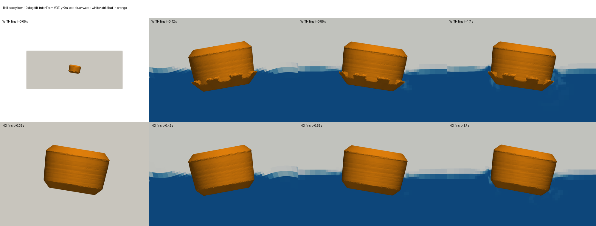

# Hull Hydrodynamics (Capytaine)

> **Summary** — First potential-flow (boundary element) study of the printed float, run with
> [Capytaine](https://github.com/capytaine/capytaine) on the wetted hull of Test Assembly 9. It gives
> heave and roll added mass, radiation damping and natural periods. It does **not** model the side
> fins (their drag is viscous). **Unverified** until a tub roll-decay test agrees.
>
> Part of [`simulations`](../README.md). Statics come from the
> [buoy-stability](../buoy-stability/README.md) solver.

---

## Hull mesh check (2026-11-11)



5,760 panels. Body of revolution built from the Fusion STL profile (no fins, no lugs). Draft 2.71 in,
waterline radius 4.65 in, flat bottom radius 3.50 in with the 45 degree bottom cone. Wetted area 123 in²,
waterplane area 68 in².

## Results

Inputs: mass 3.04 kg, GM 1.33 in, KG 2.36 in (repo solver, Test Assembly 9 budget with assumed lug and fin
masses at 1.2 g/cm³), rigid roll inertia 0.0131 kg m² (hand estimate).

| Quantity | Capytaine | Earlier hand estimate |
|---|---|---|
| Heave natural period | 0.67 s | 0.69 s |
| Heave added mass | 2.0 kg | 2.3 kg |
| Heave radiation damping ratio | 0.088 | not estimated |
| Roll natural period | 0.78 s | 0.82 to 1.00 s |
| Roll added inertia | 0.0025 kg m² | 0.008 to 0.023 kg m² |
| Roll radiation damping ratio | 0.010 | assumed 0.05 total |

## Reading it

Waves of 2 s or longer carry the buoy along; only roughly 0.8 s ripples excite roll. Wave-making damping in
roll is very small, so roll damping is mostly viscous, and the fins' drag (estimated at 0.010 to 0.015 of
critical for 8 tabs 1.97 in wide) is comparable to it. That drag estimate is a hand calculation with steady
flat-plate coefficients, not a simulation.

## Run it

```bash
python3 -m venv .venv && .venv/bin/pip install capytaine meshio numpy
.venv/bin/python hull_bem.py float_no_fins.stl
```

Export the STL from Fusion (float body, mm). The STLs are not committed.

## OpenFOAM roll-decay check (2026-11-11)



OpenFOAM v2606 `interFoam` (two-phase VOF, laminar) with a rigid-body float free to heave and roll, released from a
10 degree tilt, 3 s simulated, 141,338 cells (5 mm at the fins), 2 m tank. Two cases: the hull with 8 fins and the
same hull without. Masses are the repo solver's hull-supported masses (2.7574 kg fins, 2.674 kg no fins), so the
drafts match the statics. Scripts are in [`openfoam/`](openfoam/): `make_hull.py` (watertight STLs),
`make_cases.py` (case folders from the OpenFOAM floating-body tutorial), `analyze_decay.py` (period from the log),
`render_paraview.py` (images).

| Quantity | CFD with fins | CFD no fins | Capytaine |
|---|---|---|---|
| Roll period | 0.825 s | 0.823 s | 0.78 s |
| Swing over 3 s | 18.7 to 18.1 to 18.1 to 18.35 degrees peak to peak | grows from about 20 to about 26 degrees | n/a |

**Result: the period agrees within about 5%, which supports the mass, inertia and draft inputs. Damping is not
resolved.** Neither case decays visibly in 3 s: at a 10 degree tilt the fins move slowly, so their drag is small. The
no-fins swing growing is not physical and points to numerical energy (coarse mesh, laminar flow, motion solver), so the
fins-versus-no-fins comparison is **inconclusive**. Do not cite it as evidence that the fins help.

To redo it properly: a 30 degree or larger start, a finer mesh at the fins, a longer run, and the tub roll-decay test
as the reference. Saved field files contained denormal numbers (for example `-1.6e-312`) that OpenFOAM cannot read
back; zero them before `reconstructPar`.

## Limits

- Fins and lugs are not meshed; potential flow cannot capture fin drag. The first OpenFOAM roll-decay case is
  above and is inconclusive on damping; the tub drop test is still the reference.
- Masses and rigid inertia are estimates; the 1.2 g/cm³ lug and fin density is an assumption.
- The profile came from the Fusion STL of Test Assembly 9; the repo's printed-float v9 file agrees to about 0.04 in.
