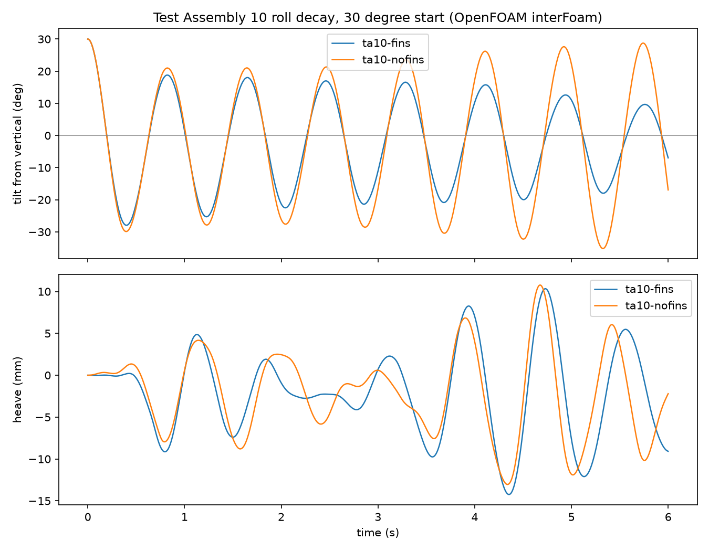
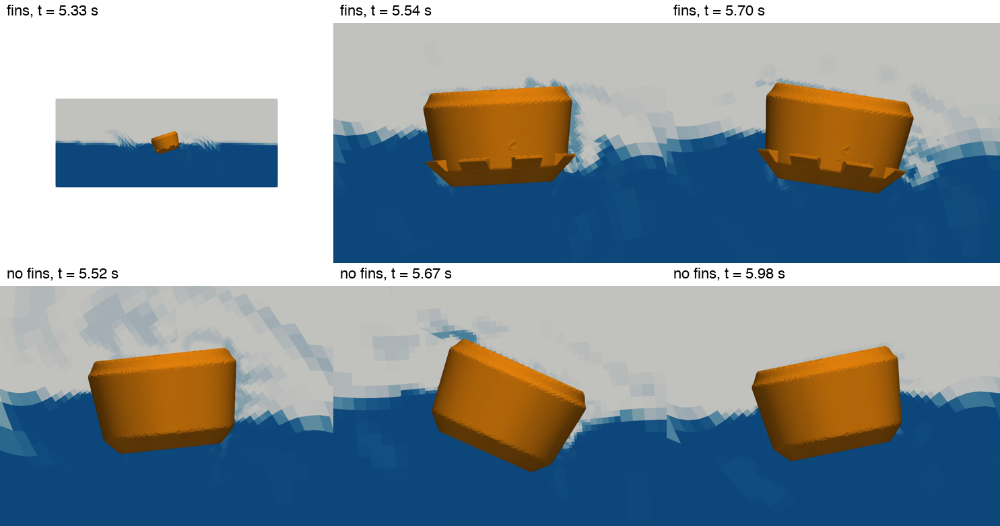

# Hull Hydrodynamics (Capytaine)

> **Summary** — First potential-flow (boundary element) study of the printed float, run with
> [Capytaine](https://github.com/capytaine/capytaine) on the wetted hull of Test Assembly 9. It gives
> heave and roll added mass, radiation damping and natural periods. It does **not** model the side
> fins (their drag is viscous). **Unverified** until a tub roll-decay test agrees.
>
> Part of [`simulations`](../README.md). Statics come from the
> [buoy-stability](../buoy-stability/README.md) solver.

---

## Hull mesh check (2026-11-11)


5,760 panels. Body of revolution built from the Fusion STL profile (no fins, no lugs). Draft 2.71 in,
waterline radius 4.65 in, flat bottom radius 3.50 in with the 45 degree bottom cone. Wetted area 123 in²,
waterplane area 68 in².

## Results

Inputs: mass 3.04 kg, GM 1.33 in, KG 2.36 in (repo solver, Test Assembly 9 budget with assumed lug and fin
masses at 1.2 g/cm³), rigid roll inertia 0.0131 kg m² (hand estimate).

| Quantity | Capytaine | Earlier hand estimate |
|---|---|---|
| Heave natural period | 0.67 s | 0.69 s |
| Heave added mass | 2.0 kg | 2.3 kg |
| Heave radiation damping ratio | 0.088 | not estimated |
| Roll natural period | 0.78 s | 0.82 to 1.00 s |
| Roll added inertia | 0.0025 kg m² | 0.008 to 0.023 kg m² |
| Roll radiation damping ratio | 0.010 | assumed 0.05 total |

## Reading it

Waves of 2 s or longer carry the buoy along; only roughly 0.8 s ripples excite roll. Wave-making damping in
roll is very small, so roll damping is mostly viscous, and the fins' drag (estimated at 0.010 to 0.015 of
critical for 8 tabs 1.97 in wide) is comparable to it. That drag estimate is a hand calculation with steady
flat-plate coefficients, not a simulation.

## Run it

```bash
python3 -m venv .venv && .venv/bin/pip install capytaine meshio numpy
.venv/bin/python hull_bem.py float_no_fins.stl
```

Export the STL from Fusion (float body, mm). The STLs are not committed.

## OpenFOAM roll-decay check (2026-11-11)


OpenFOAM v2606 `interFoam` (two-phase VOF, laminar) with a rigid-body float free to heave and roll, released from a
10 degree tilt, 3 s simulated, 141,338 cells (5 mm at the fins), 2 m tank. Two cases: the hull with 8 fins and the
same hull without. Masses are the repo solver's hull-supported masses (2.7574 kg fins, 2.674 kg no fins), so the
drafts match the statics. Scripts are in [`openfoam/`](openfoam/): `make_hull.py` (watertight STLs),
`make_cases.py` (case folders from the OpenFOAM floating-body tutorial), `analyze_decay.py` (period from the log),
`render_paraview.py` (images).

| Quantity | CFD with fins | CFD no fins | Capytaine |
|---|---|---|---|
| Roll period | 0.825 s | 0.823 s | 0.78 s |
| Swing over 3 s | 18.7 to 18.1 to 18.1 to 18.35 degrees peak to peak | grows from about 20 to about 26 degrees | n/a |

**Result: the period agrees within about 5%, which supports the mass, inertia and draft inputs. Damping is not
resolved.** Neither case decays visibly in 3 s: at a 10 degree tilt the fins move slowly, so their drag is small. The
no-fins swing growing is not physical and points to numerical energy (coarse mesh, laminar flow, motion solver), so the
fins-versus-no-fins comparison is **inconclusive**. Do not cite it as evidence that the fins help.

To redo it properly: a 30 degree or larger start, a finer mesh at the fins, a longer run, and the tub roll-decay test
as the reference. Saved field files contained denormal numbers (for example `-1.6e-312`) that OpenFOAM cannot read
back; zero them before `reconstructPar`.

## Test Assembly 10 multi-night run (run 2026-11-12 to 2026-11-13)

Rerun of the roll-decay CFD above on the [Test Assembly 10](../../cad/floatation/test-assembly-10.md) float, as
[SCO-309](https://linear.app/scout1/issue/SCO-309) asks: a **30 degree** start, a **6 s** run, and a **much finer
fin mesh**. It ran on this Mac only, with a stop and resume each morning and night. Both cases reached 6 s; results
are below.

| Item | Test Assembly 9 run | Test Assembly 10 run |
|---|---|---|
| Fin cells | 5 mm (level 3) | **1.25 mm (level 5)**, fins are their own STL region |
| Hull cells | 5 mm | 5 mm |
| Cells with fins / no fins | 141,338 / not recorded | 218,918 / 136,336 (checkMesh OK, max skewness 2.85 / 1.33, max non-orthogonality 64 / 38 degrees) |
| Start tilt, end time | 10 degrees, 3 s | 30 degrees, 6 s |
| Float mass | 2.7574 / 2.674 kg | 2.8202 / 2.7518 kg (set for the Test Assembly 10 draft estimate of 2.93 in) |
| Float geometry | Test Assembly 9 | Test Assembly 10: hull profile and fins read from the Fusion export; tip radius 124.0 mm, fins 26.0 to 44.5 mm above the keel |

Assumptions to check: the centre of gravity is the Test Assembly 9 value (59.9 mm with fins, 60.8 mm without), as
the Test Assembly 10 note says; the rigid-body inertia is unchanged (0.0131, 0.0131, 0.020 kg m^2); the hull is closed
at 158 mm above the keel (loops, lip, bore and lettering are not modelled). With those, the hull geometry gives GM of
1.25 in with fins and 1.27 in without, against the note's hand estimate of 1.30 in. The statics solver has **not**
been re-run on Test Assembly 10.

**Cost.** The 3 to 5 hours per case estimated from the start-up was too low: the step shrank to about 1.5e-4 s while
the float swung hard, and the estimate briefly read 13 to 15 hours. Both cases then finished overnight. The fins case
took 34,981 steps and the no-fins case 19,431 (the second figure includes the 0.02 s re-run described under Quirks).

### Results (Test Assembly 10, 30 degree start, 6 s)





| Quantity | CFD with fins | CFD no fins | Capytaine |
|---|---|---|---|
| Roll period | 0.824 s | 0.822 s | 0.78 s |
| Swing, first to last cycle (peak to peak) | 46.7 to 27.6 degrees | 50.9 to 63.9 degrees | n/a |
| Fitted damping ratio | +0.012 (decays) | -0.008 (grows) | +0.010 (radiation only) |
| Tilt range | +30.0 to -27.9 degrees | +30.0 to -35.2 degrees | n/a |

Absolute tilt is 30 degrees minus the logged angle (the log is relative to the start; the sign was checked against the
logged angular velocity). Peak tables and the 4-step-decimated tilt and heave series are in
[`openfoam/results/ta10/`](openfoam/results/ta10/), with the case setup in [`case-setup.md`](openfoam/results/ta10/case-setup.md), made by `extract_series.py`. The fit is the slope of the log of each
half-cycle swing against time, so it is rough.

**Reading it.**

- **The period agrees with Capytaine within 5.6 percent, as the Test Assembly 9 run did.** Fins do not move the period.
- **The fins case loses energy, at about 1.2 percent of critical damping.** That is inside the hand estimate for the
  fins alone (1.0 to 1.5 percent) and is about what Capytaine gives for wave radiation alone.
- **The no-fins case gains energy.** Its tilt reaches 35 degrees on the far side of a 30 degree release, which a float
  in still water cannot do. This is the same fault as the Test Assembly 9 run, so neither the finer fin mesh nor the
  larger start angle removed it. Laminar flow or the motion solver are the likely causes; neither was tested.
- **If the same numerical gain is in both cases, the fins add about 2 percent of critical damping at this amplitude**
  (1.2 minus -0.8). Treat that as an upper-end estimate. The gain may not be identical in the two meshes.
- Fin drag is roughly quadratic in speed, so the benefit shrinks at small angles. At the 5 to 10 degree rolls expected in
  the field it is likely a fraction of the figure above (reasoning, not simulated).

**Engineering view.** Keep the fins. With radiation damping near 1 percent of critical, the float is a near-undamped
oscillator at 0.82 s, so any added damping matters (a response at resonance scales as 1 over twice the damping ratio).
Fins cost nothing in stability (GM 1.25 against 1.27 in) and little in print effort. Do not count on them to calm small
chop, and let the tub roll-decay test with and without fins decide, run from both 10 and 30 degrees. Drop them only if
they snag lines or foul, or add print risk.

**Limits of this run.** Only the last four or five saved states exist, so the snapshots cover 5.3 to 6 s; the early swing
is not imaged (the figure for Test Assembly 9 covered 0.05 to 1.7 s). The centre of gravity and inertia are the
Test Assembly 9 values, the statics solver was not re-run, the flow is laminar, and a single start angle was run. The
simulation is unverified until the tub test agrees.

**How to run it** (scripts in [`openfoam/`](openfoam/); working folder `~/scout-cfd`, outside the repo):

```bash
# once: export the Float occurrence of Test Assembly 10 from Fusion as STL (mm, high refinement) to ~/scout-cfd/ta10_float_fins_raw.stl
python make_hull_ta10.py ta10_float_fins_raw.stl .   # watertight hulls, fins as a separate region
python make_cases_ta10.py                             # case folders in ~/scout-cfd/foam
./night.sh prepare                                    # mesh, set fields, decompose (done 2026-11-12)
./night.sh resume                                     # each night: start or continue both cases
./night.sh stop                                       # each morning: write state and stop cleanly
./night.sh status
python analyze_decay.py ~/scout-cfd/foam/ta10-fins ~/scout-cfd/foam/ta10-nofins
```

`resume` refuses to start on battery power (`--force` overrides), zeroes denormal numbers in the newest saved time
(they break a restart; 948 were found in the test), and wraps each solver in `caffeinate -dimsu` so the Mac cannot
sleep while it runs; the hold ends by itself when the solver stops. `resume --until 07:00` also stops both cases
cleanly at that time. A full write is made every 15 minutes of wall time and the last four are kept, so a crash loses
at most 15 minutes. Closing the lid still sleeps the Mac. The OpenFOAM app shell crashes on long `&&` chains and on
`rm -rf` with a glob, so `night.sh` calls it one step at a time and uses `/bin/rm`.

The log reports the rigid-body orientation **relative to the start** and the angle rises as the float rights itself, so
the absolute tilt is the start tilt **minus** that angle. `./night.sh status` draws a progress bar for simulated time,
the last restart, and the night's window, with a rough finish estimate. `analyze_decay.py` prints the relative angle;
`extract_series.py` gives absolute tilt, heave, peaks and the fit; `render_paraview_ta10.py` makes the sections.

**Quirks found in the run.**

- `timePrecision` was 6, which rounded the restart folder `5.461526` to `5.46153` and made every rank abort on resume.
  `make_cases_ta10.py` now sets 12, and the fins case was patched the same way.
- A case that ends at its end time without a final write (the log says `End`) looked unfinished to `night.sh resume`,
  which re-ran the last 0.02 s of the no-fins case. `resume` now reads the log, so a finished case is skipped.
- A case that is stopped on the clock writes no extra state at its final step, so the newest folder can sit a little
  before the end time.

## Limits

- Fins and lugs are not meshed; potential flow cannot capture fin drag. The first OpenFOAM roll-decay case is
  above and is inconclusive on damping; the tub drop test is still the reference.
- Masses and rigid inertia are estimates; the 1.2 g/cm³ lug and fin density is an assumption.
- The profile came from the Fusion STL of Test Assembly 9; the repo's printed-float v9 file agrees to about 0.04 in.
