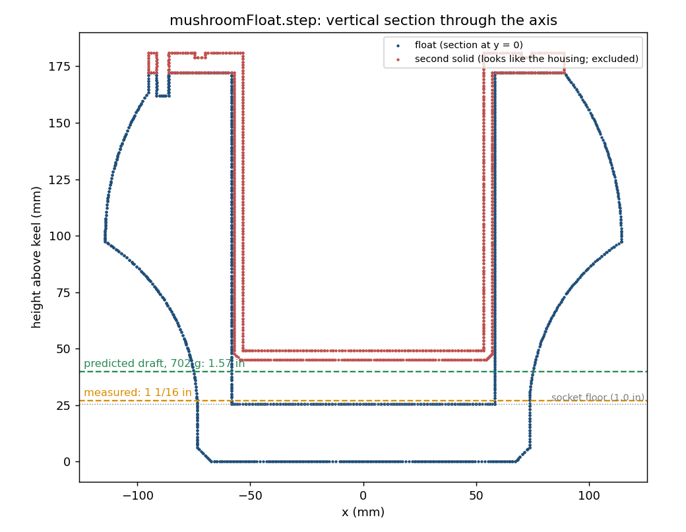
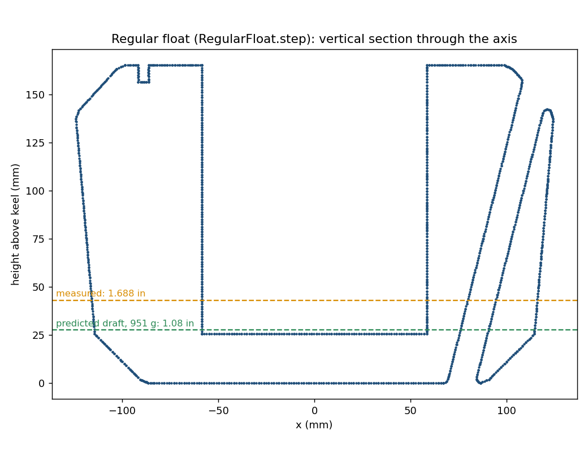
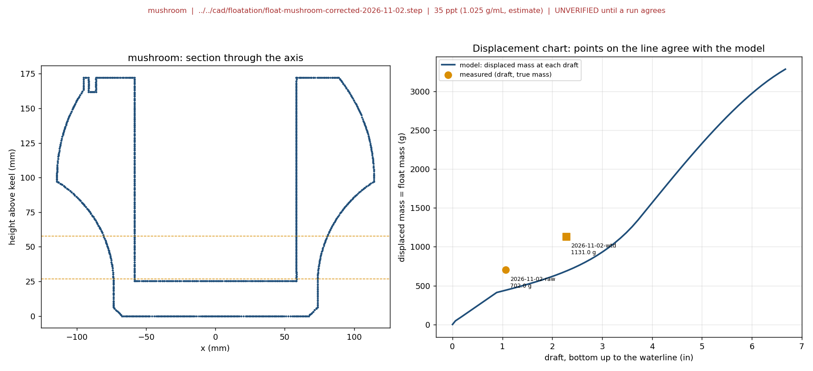
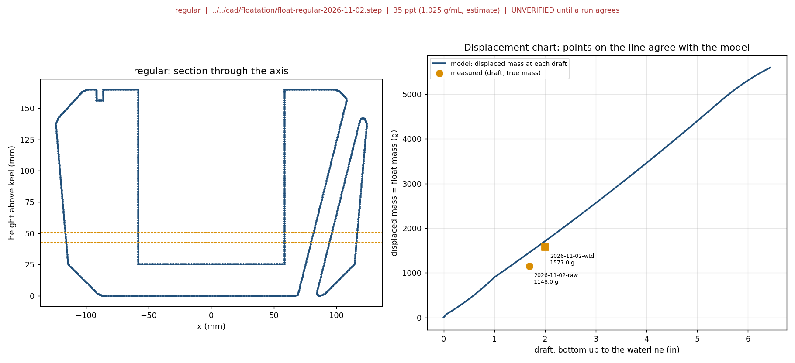

# Tub Plain-Salt Water vs Santa Cruz Seawater, Float Waterline, 2026-11-01

## One-page summary

|  |  |
|---|---|
| **Test ID / status** | RR-21 · Running (Part A locked 2026-11-02) |
| **Date, duration, who** | Plain-salt part started Mon 2026-11-02, read Tue 2026-11-03 (24 h float); seawater part tentative, Not set; John Ryan Myrdal |
| **Requirement tested** | Floats at the modelled waterline (R-17), here: does cheap plain salt give the same waterline as real seawater |
| **Tracking issue** | [SCO-292](https://linear.app/scout1/issue/SCO-292); runs with [SCO-172](https://linear.app/scout1/issue/SCO-172) |
| **Record kind** | Prospective |

**Question.** Does the same raw float (no payload) float at the same waterline in cheap plain salt water (non-iodized or kosher NaCl, mixed by mass to 35 g per kg) as in real Santa Cruz seawater? Retires the risk that the tub float tests use a water that does not match the ocean (Jes Kuczenski's ask). John decided on 2026-11-01 to use plain salt for waterline tests, so the seawater comparison checks that choice and is tentative.

**What we measured and the pass mark.**

| Parameter (unit) | Instrument | Pass if | Measured | Verdict |
|---|---|---|---|---|
| M1 salt mass (g) | Scale | Within 1% of 35 g per kg of the water | 725 g for 20 kg (target 725 g) | Pass |
| M5 freeboard of each float with 429 g inside vs the model (in) | Ruler, from the top to the waterline | Within ±0.5 in of the model | Regular: 4.5 in vs 4.66 in (-0.16 in). Mushroom: 4.5 in vs 3.38 in (+1.12 in) | Regular pass; mushroom fail (unverified, under check) |
| M3 24 h drift of each raw draft (in) | Ruler, bottom up to the waterline | Within 0.1 in of today's | Due 2026-11-03 about 11:00 | Not measured |
| M2 plain salt vs Santa Cruz seawater (in) | Ruler | Within 0.1 in | Seawater run not done (tentative) | Not measured |

**How and steps.** Raw floats (mushroom and regular), own container, 20 L of water, no fresh-water reading taken. At 11:00 on 2026-11-02, 725 g of salt (weighed in a cup on a scale) was dissolved; draft was read bottom up for each float (mean of three); at 11:40 a 429 g breadcrumb can was placed in each float's bore and freeboard read from the top (mean); the can was removed and the raw floats soak for 24 h. Results are compared with the simulator's displacement tool ([charts and log](../simulations/buoy-stability/float-displacement/README.md)).

**Result.** The salt mass is on target. The regular float agrees with the model under load (-0.16 in); the mushroom sits about 1.1 to 1.3 in shallower than the model both raw and under load, with its 702 g mass confirmed, so the mushroom model or reading is under check. The 24 h read is still to come.

**Does not establish.**

- That plain salt equals seawater for anything but buoyancy: no magnesium, calcium or sulfate, so nothing about plastic absorption, seals, corrosion or fouling.
- The actual salinity of the seawater (not metered; typically near 35 ppt, lower near runoff or after rain).
- Anything about waves, currents or biofouling.

**Decision.** Read the 24 h drift on 2026-11-03, then run a heavier-load mushroom run (and check its height and base against the STEP). Add the seawater part only if the Santa Cruz trip happens.

---

## Part A — Plan (write and date before the run)

### A1. Purpose and risk retired
Pick the cheapest water that gives an honest waterline for the tub tests ([SCO-172](https://linear.app/scout1/issue/SCO-172), the model check in R-17). Real seawater is the reference because it is what the buoy floats in. Plain salt is the working choice (John, 2026-11-01); the seawater run quantifies the error, if any.

Salt: non-iodized or kosher salt from a grocery store; example [Morton Canning & Pickling Salt, 4 lb](https://www.walmart.com/ip/seort/10318924). Read the label: no iodine, no anti-caking agent. Record the product and the price paid (Not recorded yet). Instant Ocean is not used for this test.

### A2. Hypothesis
If the buoy is floated in fresh water, in plain salt water mixed to 35 g per kg, and (if collected) in Santa Cruz seawater, then the freeboard in plain salt water differs from seawater by 0.1 in or less, because buoyancy depends on water density and density at a given salinity is set mostly by the dissolved mass, not by which ions it is.

Expected size of the difference (estimate, to be checked, not a measurement): NaCl-only water at 35 g/kg is likely a fraction of a percent less dense than seawater of the same salinity, and the seawater's own salinity is unmetered (a few ppt either way is about 0.1% per ppt in density). Each moves the draft by a few hundredths of an inch at most.

### A3. Parameters measured

| Parameter | Unit | Instrument / method | Resolution | Uncertainty | Calibrated / checked (date) |
|---|---|---|---|---|---|
| Water mass in the tub | kg | Fill from a known container or weigh the filled tub minus the empty tub | To be recorded | To be recorded | Not recorded |
| Salt mass | g | Scale | To be recorded | To be recorded | Not recorded |
| Freeboard and draft | in | Ruler or calipers against a fixed mark on the buoy, three marks, mean | To be recorded | To be recorded | Not recorded |
| Water temperature | °C | Thermometer | To be recorded | To be recorded | Not recorded |

### A4. Variables

| Kind | Variable | Value or range |
|---|---|---|
| Varied (independent) | Water type | Fresh (control), plain salt at 35 g per kg, Santa Cruz seawater (tentative) |
| Held fixed (controlled) | Buoy, payload and ballast, tub, water depth, settle time (15 min), rinse and dry between waters, water temperature within about 2 °C | Same buoy and mass throughout |
| Measured (dependent) | Freeboard and draft at three marks, water temperature, salt mass | See B2 |

### A5. Success metric (locked)

| # | Metric | Check | Pass if | Why this number | Source (spec, standard, model) |
|---|---|---|---|---|---|
| M1 | Salt mass is right | Present | Salt mass within 1% of 35 g per kg × (solution mass) | Scale resolution; 1% of 35 ppt is about 0.35 ppt, a few thousandths of an inch of draft (estimate) | This plan |
| M2 | Freeboard in plain salt vs seawater (if collected) | Accurate vs reference | Within 0.1 in of the seawater freeboard | One fifth of the ±0.5 in model tolerance in R-17, above the ruler resolution; proposed, John and Jes to confirm | [Requirements matrix R-17](../../docs/engineering/requirements-test-matrix.md) |
| M3 | 24 h drift (replaces the three-mark noise check, 2026-11-02) | Plausible | Tomorrow's draft, read the same way as today's (bottom up to the waterline, mean), is within 0.1 in of today's for each float. The mushroom was held vertical by hand for its reading, so it is judged with that caveat | Only averages were recorded, so reading noise cannot be judged; drift shows leaks, absorption or a settling error | John, 2026-11-02 |
| M4 | Fresh water is lower than the salt water | Plausible | Dropped 2026-11-02 (John): no fresh-water reading was taken before the salt was added, so this cannot be judged. A fresh baseline may be taken after the 24 h salt read | n/a | n/a |
| M5 | Matches the model, weighted floats (changed 2026-11-02) | Accurate vs reference | Freeboard (top to waterline) of each float with the 429 g can inside is within ±0.5 in of the voxel model (`assembly.py`, 35 ppt, 1.025 g/mL) | The R-17 tolerance; raw floats carry no model value, so the weighted run is the comparison | [SCO-172](https://linear.app/scout1/issue/SCO-172) |

Locked on: 2026-11-02 (John Ryan Myrdal), after the salt was added (11:00), the first waterline readings and the weighted run (11:40) had been taken, before the 24 h read. Changes made at the lock: M4 dropped; M3 replaced by a 24 h drift check; M5 moved to the weighted floats. **The M5 results were already known when it was written**, so its verdicts are not blind. Any later change goes in the deviation log (B3).

### A6. Article, setup and sampling

| Item | Value |
|---|---|
| Design revision / file | Raw floats as printed, no payload, no ballast (John, 2026-11-02): the mushroom float and the wedge/ring float. This is a raw float test, not the loaded buoy of [RR-17](rr-17-assembled-buoy-bin-float-2026-10-16.md); dry masses from the slicer (John, 2026-11-02): mushroom 702 g (also logged in the [simulator README](../simulations/buoy-stability/README.md)), regular float about 1148 g (weighed by John, 2026-11-02; the earlier 951 g was the slicer value) |
| Material and print settings | As built; do not recoat or change anything between waters |
| Configuration | Sealed, payload and ballast fixed; lid screws and glands as in RR-17 |
| Conditions | Room-temperature water; depth enough to float freely |
| Sample size and replication | 1 buoy; fresh then plain salt in the same tub; seawater run if collected |
| Control / reference article | Fresh water is the control; real seawater is the reference (tentative) |
| Reference instrument or standard | Seawater (tentative). No salinity meter: salinity comes from mass |
| Expected values | Fresh: lowest freeboard. Plain salt: higher than fresh. The model's 4.27 in assumes the whole buoy with payload and does not apply to raw floats; an empty float may sit tilted (the mushroom did) |
| Water | The buoy float has its own container, separate from the RR-23 housing bucket. Weigh this container's water before adding salt |
| Before you start (go/no-go) | Buoy dry outside and weighed (if mass changed since the last float, reweigh and stop to find out why). Tub clean, no residue. Salt label read: no iodine, no anti-caking agent |
| Data path | Handwritten sheet or a notes file in the repo, photographed ruler readings; enter into B2 the same day |
| Stop and abort conditions | Buoy leaks (weeping seam); water cloudy after stirring; seawater has visible growth or smell |
| Safety | Salt-water spills (slip), carrying buckets, tub weight. Seawater collection hazards below. Hazard form: [SCO-211](https://linear.app/scout1/issue/SCO-211) (signed by Shoba Krishnan and submitted, per John 2026-11-02; whether it covers this test is unchecked) |

> **Unverified, under check (2026-11-02):** the diagrams and the predicted drafts built from these STEP files may contain errors. The measured drafts do not match the predictions (see C2), and the cause is not yet known: it could be the CAD, the printed masses, water inside a float, or the reading method. They are saved as the working record and will be corrected once checked.

Article sections (vertical cut through each float's axis, from the STEP files; dashed lines mark the predicted and measured drafts):

### A6a. Hazards, damage risks and failure modes

| What could go wrong | What happens | How you would notice | Fix or prevention |
|---|---|---|---|
| Iodized or anti-caking salt used | Cloudy water, extra additives | Cloudy solution, residue | Non-iodized or kosher salt only; read the label |
| Salt mass wrong (volume scoops, wrong water mass) | Salinity wrong by several ppt, no meter to catch it | Freeboard far from the model | Weigh the water and the salt; salt mass = water mass × 35/965; recheck the arithmetic before adding |
| Salt not fully dissolved | Layered water, low density at the top | Crystals on the bottom, freeboard drifts | Stir several minutes, circulate, wait for the 15 min settle |
| Seawater changes in the bucket | Growth, smell, cloudy water | Visible growth or odor | Collect within a day or two of the test; keep sealed and cool; discard and recollect if it changes |
| Harbor water diluted by rain or runoff | Salinity well below open ocean | Freeboard lower than the plain-salt run | Collect away from outfalls, not right after rain; record weather; read the result with that in mind |
| Salt on the buoy or hardware | Corrosion of metal parts, crystal crust | White residue | Rinse with fresh water and dry after the day's runs |
| Slippery rocks or surf at the collection site | Fall, injury | Wet or surging site | Collect from a pier or ramp, never alone, skip bad surf; check whether a sample needs any permit (Not recorded) |
| Disposal of salt water | Environmental or plumbing issue | n/a | Ask EHS and campus rules before pouring out (Not recorded); do not pour into storm drains |

### A7. Procedure

**Prerequisites checklist.**

- ☐ Non-iodized or kosher salt (about 4 lb boxes; amount set by the tub's water mass in step 2; [example](https://www.walmart.com/ip/seort/10318924))
- ☐ Scale for the salt; a way to weigh or measure the tub's water; thermometer; ruler or calipers
- ☐ Tub (two on hand), clean; towels; fresh water for rinsing
- ☐ For the seawater part (tentative): clean food-grade buckets or jugs with lids, rinsed with fresh water, labeled with date and site; enough volume to float the buoy in the tub (volume Not recorded)
- ☐ Camera for the ruler readings; the buoy weighed and its configuration recorded
- ☐ Hazard form signed (done, per John 2026-11-02); confirm its scope covers this test ([SCO-211](https://linear.app/scout1/issue/SCO-211))

| Step | Action | Record | Expected | Done |
|---|---|---|---|---|
| 1 | Weigh the buoy dry; check the go/no-go items in A6. | Mass, date | Equal to the last float's mass | ☐ |
| 2 | Fill the tub with fresh water; measure the water mass. | kg of water | Plausible for the tub size | ☐ |
| 3 | Float the buoy in fresh water; settle 15 min; read draft and freeboard at three marks. | Not done: no fresh reading taken (John, 2026-11-02) | n/a | ☐ |
| 4 | Compute salt mass = water mass × 35/965 (for example 40 kg of water needs 1.45 kg of salt; 100 kg needs 3.63 kg). Weigh the salt. | Salt mass, arithmetic | Within 1% of target (M1) | ☐ |
| 5 | Dissolve the salt in the same tub, stirring until clear; settle 15 min; read draft and freeboard at three marks. | in at each mark | Not compared to fresh (M4 dropped); the 4.27 in model does not apply to raw floats | ☐ |
| 6 | Leave the buoy floating 24 h; check seams and hardware for weeping or leaks; read again. | Leak yes/no, in | No weeping at the seams | ☐ |
| 7 | Seawater part (tentative): rinse and dry the buoy and tub; fill with seawater as collected; settle 15 min; read at three marks. | in at each mark | Close to the plain-salt run (M2) | ☐ |
| 8 | Rinse and dry the buoy and hardware; photograph; weigh it again. | Mass | Equal to step 1 | ☐ |

### A8. Analysis plan
Mean freeboard per water over the three marks. Spread across marks against 0.05 in (M3). Plain-salt freeboard against the model's 4.27 in (M5). If seawater was run, the difference from plain salt against 0.1 in (M2).

### A9. Curve required

| Curve | Axes and units | Standard or model compared against | Range to cover | Acceptance for the fit |
|---|---|---|---|---|
| Validation: freeboard vs salinity | Salinity (ppt, from mass) on x, freeboard (in) on y | The buoy stability model's freeboard | Fresh (0 ppt) and 35 ppt (plus seawater, plotted at an assumed 35 ppt, tentative) | Salt point within the ±0.5 in model tolerance in R-17 |

### A10. Review and open questions

| Reviewer | Sent (date) | Feedback | Change made to Part A |
|---|---|---|---|
| Jes Kuczenski (GENG advisor; asked for the seawater reference) | Not sent | | |

Open questions:

- **Mushroom hypothesis (John, 2026-11-02):** the unweighted mushroom is unstable, which makes its reading unreliable. Planned: a repeat with a lot more weight (a heavier load stands it upright). Predicted drafts / freeboard from the top for the 702 g float plus added mass (voxel model, 35 ppt, estimates, unverified): +429 g 3.43 / 3.35 in; +800 g 3.90 / 2.88 in; +1200 g 4.49 / 2.29 in; +1600 g 4.96 / 1.82 in; +2000 g 5.55 / 1.23 in. Record the mass and where it sits each time. Owner John, date not set.
- Weights: John will add weights to the floats later, in the same salt water. Record each float's added mass and re-read freeboard at three marks. Compare with the model's 4.27 in (M5) only if the added mass matches the model's payload mass for that float (Not recorded). Owner John.
- Is 0.1 in the right tolerance for M2? Owner John with Jes, before locking.
- Tub water mass: measured Mon Nov 2 in step 2; salt mass computed from it. Owner John.
- Santa Cruz seawater trip: tentative for the weekend of Nov 7–8; may be dropped. Owner John.
- The pod seal soak ([SCO-176](https://linear.app/scout1/issue/SCO-176)) and the 4-week soak ([SCO-180](https://linear.app/scout1/issue/SCO-180)) use real seawater or a marina, not plain salt (John, 2026-11-01). Confirm the water for SCO-176. Owner John.

## Part B — Execution log (fill during the run)

### B1. Run record

| Item | Value |
|---|---|
| Start / end (date, time) | Salt added 2026-11-02 11:00; weighted readings 11:40; 24 h read due 2026-11-03 about 11:00 |
| Operator | John Ryan Myrdal |
| Ambient conditions | Outdoors, daylight; room-temperature water (value Not recorded) |
| Instrument serials / IDs | Scale (model and resolution Not recorded); ruler (smallest tick assumed 1/16 in, Not recorded) |

### B2. Raw data

| Time | Run / sample | Reading or observation | Reference value | Note |
|---|---|---|---|---|
| 2026-11-02 11:00 | Salt addition | Salt measured by mass: poured into a cup standing on a scale, then added to the tub: **725 g exactly** (John). Water at room temperature (value Not recorded) | 725 g for 20 L (35 g per kg) | M1 met on the stated amounts: 725 g is 35 g per kg of 20 kg. Water amount (20 L) and its measurement method Not recorded. 24 h read due 2026-11-03 11:00 |
| 2026-11-02, time Not recorded (after the salt) | Mushroom float (702 g), salt water | **Draft (measured from the very bottom of the float up to the waterline): mean of three readings, one smallest ruler tick above 1 in, about 1 1/16 in (1.0625 in)** if the smallest tick is 1/16 in. Free-floating it tilts (the tilted dome float in the photos); John held it vertical with a side-only force, at maximum draft, and recorded that. The three individual readings are Not recorded | Raw float, no model value | John, verbal. Smallest tick size Not recorded |
| 2026-11-02, time Not recorded (after the salt) | Regular float (951 g slicer; weighed about 1148 g later), salt water | **Draft (very bottom up to the waterline): mean of three readings, one smallest ruler tick below 1 3/4 in, about 1 11/16 in (1.6875 in)** if the smallest tick is 1/16 in. Floats upright unaided (the upright engraved float in the photos). The three individual readings are Not recorded | Raw float, no model value | As above |
| 2026-11-02, time Not recorded (after the first readings) | Weighted run, both floats, salt water | **429 g of mass placed inside each float**: a cylindrical can of breadcrumbs standing in the middle of the float's compartment (the central bore, on its floor), per John. The can went in at 11:40 and was taken out after the weighted readings, so the 24 h salt soak is of the raw floats. Averages only (John). Waterline measured from the top of each float down to the water: **both about 4.5 in**. Single averaged value each; only the averages are used (John). Regular float alone weighed about 1148 g; mushroom 702 g confirmed correct | See C2 | John, verbal |
| 2026-11-03 13:00 | Regular float, salt water (24 h on) | **Top of the buoy to the water: 5 3/8 in (5.375 in).** John is ignoring the mushroom float from here. What was inside the float (the 429 g can was removed after the weighted readings), which mark was read and the water temperature are Not recorded | Weighted run: 4.66 in with 429 g; model 4.27 in for the whole buoy | Not compared to a pass mark yet: if the float was raw, there is no model value; if it carried payload, M5 would be +0.7 in off the 4.5 in prediction, outside ±0.5 in. Confirm the configuration before using it |

### B3. Deviations

| Time | What differed from A7 | Why | Effect on validity |
|---|---|---|---|
| 2026-11-02 | No fresh-water freeboard reading was taken before the salt was added (step 3 not done); M4 dropped from A5 before the lock | John did not measure it | The fresh-to-salt waterline shift cannot be derived from this run. What remains: salt-water freeboard of the raw floats, reading noise (M3) and the 24 h seam-leak check. Option: float them in fresh water after the salt read to get the baseline |

## Part C — Results and decision (fill after)

### C1. Result against the metric

| Metric (from A5) | Measured | Margin | Verdict |
|---|---|---|---|
| M1 salt mass | 725 g for 20 kg (target 725 g) | on target | **Pass** |
| M2 plain salt vs seawater | Not yet run | — | Not measured |
| M3 24 h drift | Due 2026-11-03 | — | Not measured |
| M4 fresh lowest | Dropped: no fresh reading | — | Not measured |
| M5 weighted vs model | Regular: 4.5 in measured vs 4.66 in predicted (-0.16 in). Mushroom: 4.5 in vs 3.38 in (+1.12 in) | ±0.5 in | Regular **Pass**; mushroom **Fail** (unverified, under check) |

**Overall:** Partial so far: M1 pass; M5 pass on the regular float and fail on the mushroom; M3 due tomorrow; M2 not run.

### C2. Curve and analysis
Preliminary (2026-11-02, before the 24 h read; not a verdict). **Unverified, under check.** Predictions come from the float displacement tool ([README, charts and method](../simulations/buoy-stability/float-displacement/README.md); running log [float-displacement-log.csv](float-displacement-log.csv)): true 3D hull from the STEP, open bore not counted, 1.025 g/mL for 35 ppt (an estimate). Geometry: [mushroom (corrected)](../cad/floatation/float-mushroom-corrected-2026-11-02.step) and [regular](../cad/floatation/float-regular-2026-11-02.step). Section diagrams: [mushroom](mushroom-float-cross-section-2026-11-02.png), [regular](regular-float-cross-section-2026-11-02.png).

**The two displacement charts (kept running for future buoyancy tests):**

| Run | Mass | Reading (John, mean) | Predicted | Measured minus predicted draft |
|---|---|---|---|---|
| Mushroom, raw | 702 g | draft 1.06 in (held vertical by a side-only force) | draft 2.33 in | -1.27 in |
| Regular, raw | 1148 g (weighed) | draft 1.69 in | draft 1.31 in | +0.37 in |
| Mushroom + 429 g can | 1131 g | freeboard 4.5 in (draft 2.28 in) | freeboard 3.38 in (draft 3.40 in) | -1.12 in |
| Regular + 429 g can | 1577 g | freeboard 4.5 in (draft 2.00 in) | freeboard 4.66 in (draft 1.84 in) | +0.16 in |

Notes:

- **Which is which (John):** the mushroom is the dome-shaped float that tilts when free; the regular float is the upright one with the engraved band.
- **Corrections made during the session** (kept here so they are not lost): an early version used a body-of-revolution envelope that counted the open central bore as displacing water, then the wrong STEP files (one held the housing, one was assumed to be the regular float), and the regular float's mass was the slicer's 951 g before it was weighed at about 1148 g. Only the voxel method and the weighed masses are used now.
- **Sections:** both floats have a central bore of about 58 mm radius from the top down to a floor 25.4 mm above the keel (about 107 g of water per 10 mm of depth). The regular float is not axisymmetric: one side shows a hollow wedge, the other a plain wall.
- **Regular float:** with its weighed mass the weighted run agrees with the model within 0.16 in; the raw run is 0.37 in deeper than predicted (a single low-draft reading).
- **Mushroom:** mass confirmed (702 g), yet it reads about 1.1 to 1.3 in shallower than predicted raw and weighted. A near-constant offset points to the reference or the geometry (for example the real overall height or base differing from the STEP: 6.78 in tall, 1.06 in base), not the mass; two points cannot separate an offset from a proportional error. Check the printed mushroom's overall height and base.
- **Mushroom hypothesis (John):** its instability makes the unweighted reading unreliable; it needs a lot more weight. Predicted drafts / freeboard from the top for the 702 g float plus added mass (35 ppt, estimates, unverified): +429 g 3.43 / 3.35 in; +800 g 3.90 / 2.88 in; +1200 g 4.49 / 2.29 in; +1600 g 4.96 / 1.82 in; +2000 g 5.55 / 1.23 in.

### C3. Validity and limits

- Does establish (so far): the salt mass was on target; the regular float's weighted freeboard matches the model within 0.16 in.
- Not established: the 24 h drift, the mushroom model, and equivalence with seawater.
- Will not establish: that plain salt matches seawater for material, seal, corrosion or fouling tests; the seawater's actual salinity.

### C4. Decision

| Question | Answer |
|---|---|
| Good enough to stop redesigning? | Not yet known |
| Design change driven by this test | None expected; confirms the water for tub waterline tests |
| Re-run needed? | Not yet run |
| Next test | The 4-week soak in real seawater or at a marina ([SCO-180](https://linear.app/scout1/issue/SCO-180)) |
| Issues filed | [SCO-292](https://linear.app/scout1/issue/SCO-292) |

### C5. Evidence and traceability

- Section diagrams (**unverified, errors being checked; see A6 and C2**): [mushroom](mushroom-float-cross-section-2026-11-02.png), [regular](regular-float-cross-section-2026-11-02.png); CAD: [mushroom (corrected)](../cad/floatation/float-mushroom-corrected-2026-11-02.step), [regular](../cad/floatation/float-regular-2026-11-02.step)
- Photos, 2026-11-02 (fresh-water float, then salt; readings not yet taken from them): floats [side view](float-salt-test-2026-11-02-01.jpg), [waterline on the engraved side](float-salt-test-2026-11-02-02.jpg), [second float tilted](float-salt-test-2026-11-02-03.jpg), [front](float-salt-test-2026-11-02-04.jpg), [top-down in the tub](float-salt-test-2026-11-02-05.jpg); salt [in the mixing cup](salt-mixing-rr-21-2026-11-02-01.jpg), [pouring water](salt-mixing-rr-21-2026-11-02-02.jpg), [pouring salt](salt-mixing-rr-21-2026-11-02-03.jpg)
- Requirement R-17 (floats at the modelled waterline) → this test → [SCO-292](https://linear.app/scout1/issue/SCO-292); related: [RR-17](rr-17-assembled-buoy-bin-float-2026-10-16.md), [RR-19](rr-19-petg-water-absorption-soak-2026-10-21.md)

Format: [Test Record Template](../../docs/engineering/test-record-template.md). Index: [risk-reduction register](risk-reduction-register.md).
