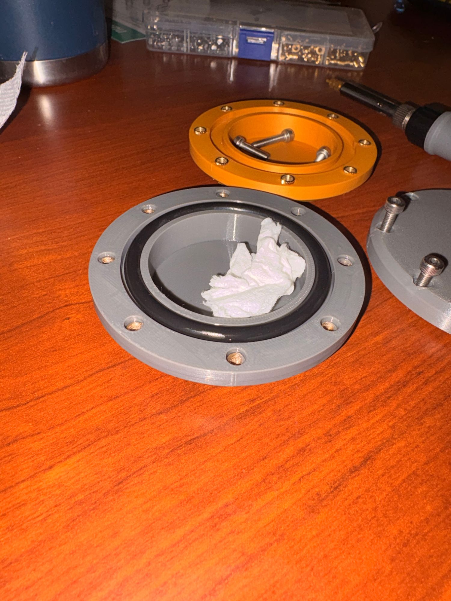

# Turbidity Sensor Housing — PETG Submersion Pass, 2026-10-21

> **Summary** — The remodelled turbidity sensor pod stayed dry for 24 hr submerged. This is the
> first passing run of the face-seal design with a purchased O-ring. Two things made the
> difference, per John: **printing the pod in PETG**, and **pressing the heat-set inserts in
> from the bottom** of the flange. Fresh water, no sensor, negligible depth, so this is a seal
> check only, not the salt-water or pressure validation.

---

## Method

Dry paper towel inside the pod, O-ring seated, bolts tightened, then submerged for 24 hr in
**fresh water** at **negligible depth** with **no sensor fitted**. Opened afterwards and
inspected. Recorded by John; no timestamped start/stop log.

## Result

✅ **Pass** — the paper towel was dry on opening.

## What changed against the failed runs

| Change | Why it matters |
|---|---|
| Printed in **PETG** | John's call on what separated this run from the earlier floods ([RR-15](risk-reduction-register.md), the [TPU-ring failure](sensor-housing-tpu-oring-failure-2026-09-12.md)) |
| Heat-set inserts pressed in **from the bottom** | Pressed in from the top, the hot inserts slightly deformed the flange face and reduced even clamping around the O-ring |

## What this does and doesn't establish

- **Does:** the face-seal joint can hold a dry interior for 24 hr when the print material and
  insert direction are right. This clears the submersion gate for
  [SCO-91](https://linear.app/scout1/issue/SCO-91).
- **Doesn't:** salt water (~35 ppt), the 5 m-equivalent pressure target, the 1-week soak with the
  sensor live ([SCO-176](https://linear.app/scout1/issue/SCO-176)), or the electronics-housing
  clamp, which is still untested under [SCO-108](https://linear.app/scout1/issue/SCO-108).
- **Not recorded:** exact CAD revision, bolt count and torque. The photo shows eight inserts in
  the body. Confirm these against the STEP before citing them as the design baseline.
